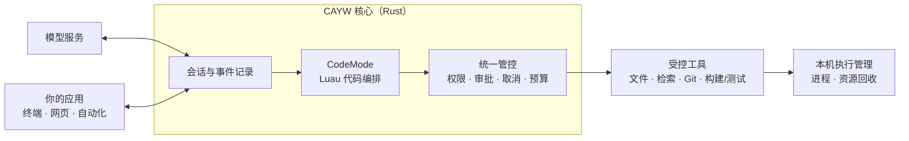

<div align="center">

# CAYW

**Code As You Wish — 让模型写代码来调用工具的开源 Agent 运行时**

*An open-source, Rust-native agent runtime where the model orchestrates tools through code.*


</div>

## 我们的愿景

**让你的想法变成可靠的行动，让你始终掌控过程。**

CAYW 是一个正在开发的开源 Rust Agent 运行时。我们希望让模型通过代码组织工具，把理解任务、执行操作和验证结果连成一个完整过程，而用户始终决定它能访问什么、哪些操作需要确认，以及最多使用多少资源。

开发者可以按需要组合模型、工具、界面和插件，构建自己的 Agent 应用。终端、网页和自动化程序通过公开接口接入同一个可独立运行的核心，不必把任务绑在某个界面或一次进程运行上。

我们的目标是：执行有记录，操作能取消，中断后先核对再继续。让 Agent 不只是给出建议，也能在清楚的权限和资源边界内，把事情做完。

> 项目正在开发中，首发面向 **macOS**。以上是建设目标，当前交付范围与进度见[开发路线图](docs/development-map.md)。

## 核心思路

- **用代码组织工具**：模型写短段 Luau 脚本，把读取、分析、修改和验证组织起来。这种工具编排方式称为 **CodeMode**。
- **控制权留给用户**：文件访问、工具调用、操作确认和资源预算都有明确边界；不会因为一段脚本获准，就放行其中的所有操作。
- **核心独立运行**：对话和工具执行不依赖终端、网页、远程服务或插件。界面是入口，不是核心运行的前提。
- **会话不绑死在进程上**：保存任务与执行记录；恢复时先核对已经发生的操作，不盲目重复执行。
- **按需组合能力**：通过公开接口接入模型、工具和插件，让开发者构建适合自己工作方式的应用。

## 它怎么工作

模型负责组织步骤，CAYW 负责检查和执行每次工具调用。权限、审批、取消、预算和执行记录贯穿整个过程。



例如，模型可以通过一小段 Luau 代码列出 Rust 文件，并查找公开函数声明：

```lua
local files = cayw.call('fs.glob', {
  path = '.', pattern = '**/*.rs'
})
local matches = cayw.call('fs.grep', {
  path = '.', pattern = '^pub fn', multiline = true,
  max_matches = 20
})
return { files = files, matches = matches }
```

每个 `cayw.call` 都要独立经过参数检查、授权、预算检查和结果记录。遇到无法确认是否已经执行的操作时，停止并核对，而不是自动重做。

## 本地体验

macOS Apple Silicon 发行包解压后，在包目录运行 `sh install.sh` 即可安装 `cayw`、`cayw-tui`、`cayw-webui` 和 `cayw-client`，默认位置为 `~/.local/bin`。用 `--prefix DIR` 改到 `DIR/bin`；目标已有不同程序时需加 `--force`。脚本会核对 `SHA256SUMS`，不联网、不使用 sudo、不修改 shell 配置。`scripts/install-cli.sh` 是发行包安装入口，发布时位于包根目录并命名为 `install.sh`；从源码构建仍需下面的 Cargo 命令。

安装完整发行包后，在项目目录直接运行 `cayw` 即可启动或复用设备上唯一的 Client，并进入 TUI；`cayw start` 是同一入口。TUI 和 WebUI 都由这个 Client 统一连接和监管，不为每个工作区保存独立连接状态。网页是可选界面，使用 `cayw --ui web` 显式启动，本地默认免登录。显式 `--lan IP:PORT` 开放局域网访问，未配置账号时直接放行；在本机网页“设置 → 局域网访问账号”中可配置或修改可选账号，保存后立即应用于当前局域网入口；本地访问仍免登录。局域网启动同时提供仅回环可达的本机管理地址，普通远端访客不能配置账号。CLI 账户命令保留为备用。`--workspace DIR` 选择初始工作区；网页侧栏可连接或切换已经通过 `cayw init --workspace DIR` 登记的项目，旧工作区任务继续运行。各工作区保存独立的目录、SQLite、会话、模型选用和架构插件启用关系。网页“设置”可管理模型方案和本地 External 架构插件；模型切换用于后续任务，运行中任务保留原模型。插件先登记，再按工作区经显式批准启用；其进程仍由唯一 Client 统一启动和停止。普通聊天无需插件。详见[本地工作流](docs/local-workflows.md)。源码打包入口为 `sh scripts/package-cli.sh OUTPUT_DIRECTORY`（macOS arm64）。


需要 **Rust 1.95+** 从源码运行离线示例：

```sh
cargo run -p cayw-agent --example offline --locked
```

示例使用预设的模型消息调用 Rust 加法工具，不连接模型服务，也不需要 API Key。示例输出：

```text
tool start: add {"a":2,"b":3}
tool result: 5
assistant: 2 + 3 = 5
completed: 5 messages, running=false
```

终端交互界面直接运行 `cayw`，默认以当前目录作为工作区并启动或复用唯一 Client。已有显式 `cayw serve` Client 时，`cayw tui` 可作为只连接入口，选择会话、发送消息、审批和取消。TUI 的所有工作区请求都经同一个 Client 路由；工作区不保存自己的连接地址或进程生命周期。快捷键见 [TUI 说明](crates/cayw-tui/README.md)。

安装独立 Runtime 和 Rust 客户端后，可以通过 Rust SDK 或认证本机 IPC 使用同一个持久会话。使用默认位置时，`cayw serve` 会自动初始化数据根（macOS 为 `~/.cayw`，可用 `CAYW_HOME` 指定专用根），并成为设备上唯一的本地 Client；工作区默认为当前目录。完整显式提供 `--db`、`--token-env` 和 `--config` 时，服务进入独立 Headless 模式，不读取或创建默认数据根。没有配置模型时，Client、TUI 和 WebUI 都能正常启动；创建和查询可用，第一次 `prompt`、`enqueue` 或 `resume` 返回 `model_not_configured`，不会发送模型请求。可以用固定响应做离线演示：

```sh
cayw serve --offline --demo-authorized
# 另一终端，在同一目录
cayw-client create
cayw-client prompt --session SESSION_ID --text 'Run the offline demo'
```

演示只预先授权两个精确文件调用（写入并读取 `cayw-demo.txt`）。本地产品只通过 `cayw conf` 首次配置模型。模型方案写在设备级的 `<CAYW_HOME>/models.json`。各工作区只在自己的 `model-selection.json` 里保存选用。发现旧的工作区 `models.json` 时，Client 单向合并进设备列表，新文件都写成功后才删除旧文件。密钥作为可选普通明文字段 `api_key` 保存；新建方案时留空表示模型服务不需要认证。编辑已有方案时，密钥留空会保留同一服务地址的原值，删除密钥需要明确选择清除；更换服务地址时必须提供新密钥或明确清除，旧密钥不会自动转移。启动不会弹出配置向导。旧 `config.json.model` 只在迁移时读取，迁移后删除。可发现的本地 Client 还会打开主 session 工作区，默认目录是 `$HOME/CodeAsYouWish`，绝对路径 `CAYW_MAIN_SESSION` 优先。只有完整显式 Headless 的 `--config` 继续以 `config.model` 为权威来源，并且不创建主 session 目录。安装、宿主配置、两回合文件任务、审批与取消见[无界面对话指南](docs/headless-chat.md)。

## 文档与参与

- [架构设计](docs/architecture.md)：组件职责、执行流程与恢复规则。
- [开发路线图](docs/development-map.md)：交付计划、当前进度与验收记录。
- [记忆、上下文与主动工作设计](docs/memory-context-work.md)：主 session、WorkItem、上下文压缩、审批询问与恢复点的目标设计。
- [可视化编辑](docs/visual-editor.md)：HTML/CSS、Vite React 与 Vue 3 页面的直接编辑和源码保存。
- [贡献指南](CONTRIBUTING.md)：开发环境、构建、测试与提交要求。
- [AI 编程助手说明](AGENTS.md)：在本仓库工作时需要遵守的规则。

欢迎通过 [Issues](https://github.com/changw98ic/CAYW/issues) 讨论使用场景、设计和问题，也欢迎参与实现。

## 许可证

项目源码使用 [Apache License 2.0](LICENSE)。macOS 发行包另外包含按锁定依赖生成的 `THIRD-PARTY-NOTICES` 和所需第三方许可文本；这些文件也列入包内 `SHA256SUMS`。
