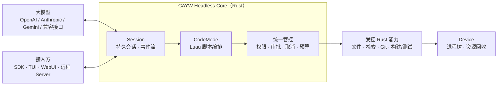

<div align="center">

# CAYW

**Code As Your Wish — 让模型写代码来调用工具的开源 Agent 运行时**

*An open-source, Rust-native agent runtime where the model orchestrates tools by writing code, not by calling them one by one.*


</div>

> [!IMPORTANT]
> **CAYW 目前处于规划阶段，还没有可运行的代码。** 本页描述的是设计目标，不是已有功能。进度以 [GitHub Issues](https://github.com/changw98ic/CAYW/issues) 的验收结果为准。
>
> CAYW is in early planning. Nothing below is implemented yet.

## 一句话说明

CAYW 是一个**给 AI Agent 用的“操作系统内核”**：你接入任意大模型，它负责让模型安全地读写文件、搜索代码、跑测试、管理进程，并且可以中途取消、断电恢复、限制花费。

它不是又一个聊天界面，也不是某个模型的封装，而是界面、IDE 插件、自动化流程都可以接上去的那一层**无界面运行时**。

## 为什么要做

现在大多数编程 Agent 有两个问题：

| 常见做法 | 带来的问题 | CAYW 的做法 |
| --- | --- | --- |
| 模型一次调用一个工具，每步都要来回一轮 | 慢、费 token，多步任务容易中途走偏 | **CodeMode**：模型写一小段 Luau 脚本，一次编排多个工具调用 |
| 直接给模型一个 Shell | 权限无边界，跑出去的进程管不住、停不下 | 默认**不给 Shell**，只提供预置的受控能力；真需要时按任务申请、限定范围 |
| 会话和执行绑死在一个进程里 | 崩溃或断线后无法安全恢复，可能重复执行有副作用的操作 | **会话与执行者分离**；恢复前先核对“不确定是否已执行”的操作，不盲目重放 |

## 它怎么工作



模型拿到的不是一堆零散工具，而是一个可以写脚本的受控环境。下面是一个**设想中的示意**（不是真实 API，接口仍在设计中）：

```lua
-- 示意：模型生成的 CodeMode 脚本，一次完成“找到失败测试并读出相关代码”
local result = cayw.test.run({ filter = "auth" })
for _, failure in ipairs(result.failures) do
  local src = cayw.fs.read(failure.file, { around = failure.line, lines = 30 })
  cayw.emit({ test = failure.name, snippet = src })
end
```

每一步都经过同一套权限、取消和预算检查；脚本里没有任意执行命令的入口。

## 设计原则

- **Headless 优先**：内核单独就能跑完整的多轮对话和工具执行，界面、远程服务、工作流都是可选插件。
- **AI Native**：工具接口为“模型写代码来用”而设计，而不是为人点按钮设计。
- **默认最小权限**：不向 Agent 暴露 Bash / Shell / Node / Python 通用入口，缺什么能力按任务申请。
- **可恢复、可取消**：任何执行都能被打断；崩溃后能恢复，且不会重复做已经做过的事。
- **模型无关**：逐个接入 OpenAI、Anthropic、Gemini 及兼容接口，只标注实际验证过的能力。
- **不依赖 Codex**：CAYW 是 [WinWinCode](https://github.com/changw98ic/winwincode) 与 [CodePatchBay](https://github.com/changw98ic/codepatchbay) 的后续方向，目标是完全替换它们对 Codex 内核的依赖。

## 模块一览

| 模块 | 作用 | 必需？ |
| --- | --- | --- |
| Headless Core | 会话、事件、CodeMode、权限与调度 | 必需 |
| Device | 管理本机执行进程、资源与内容存放 | 必需 |
| SDK / IPC | 供外部程序接入的公开接口 | 必需 |
| TUI / WebUI | 终端界面 / 网页界面，可单独安装 | 可选 |
| Server | 远程接入；设备只需主动连出，不开放端口 | 可选 |
| StrongFlow / JEv / Fusion / Observer | 强流程、扩展与诊断模块，可插拔 | 可选 |

## 路线图

| 阶段 | 目标 | 状态 |
| --- | --- | --- |
| A | 最小 SDK 与 IPC、三平台验证基线、Luau CodeMode 原型、最小进程管理 | 计划中（当前重点） |
| B | 只用内核跑通第一个真实的流式多轮对话 + 工具执行 | 计划中 |
| C | 崩溃恢复、按需权限申请、MCP / Skills 接入、多模型、多会话并发 | 计划中 |
| D | 模块接口、TUI、WebUI、远程 Server、可插拔扩展 | 计划中 |
| E | CPU / 内存 / GPU 资源策略与内容存放、可选加密同步 | 计划中 |

完整的 18 个任务、依赖关系和验收标准见 [开发路线图](docs/development-map.md)。

## 参与

项目还在早期，现在最有价值的参与方式是：

- 在 [Issues](https://github.com/changw98ic/CAYW/issues) 里讨论设计、指出问题或补充验收场景；
- 关注 Stage A 的任务（#1–#5），它们是后续一切的基础。

**给 AI 编程助手：** 在本仓库工作前请先读 [`AGENTS.md`](AGENTS.md) 和 [`docs/development-map.md`](docs/development-map.md)。

## 许可证

[Apache License 2.0](LICENSE)
