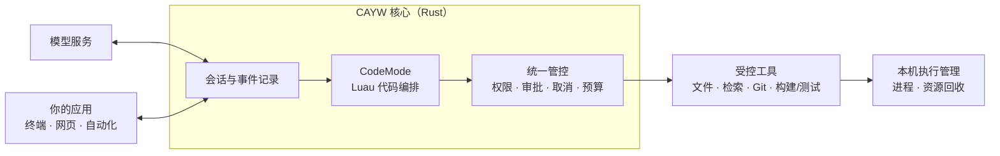

<div align="center">

# CAYW

**Code As You Wish — 让模型写代码来调用工具的开源 Agent 运行时**

*An open-source, Rust-native agent runtime where the model orchestrates tools through code.*


</div>

## 我们的愿景

**让你的想法变成可靠的行动，让你始终掌控过程。**

CAYW 是一个正在开发的开源 Rust Agent 运行时。我们希望让模型通过代码组织工具，把理解任务、执行操作和验证结果连成一个完整过程，而用户始终决定它能访问什么、哪些操作需要确认，以及最多使用多少资源。

开发者可以按需要组合模型、工具、界面和插件，构建自己的 Agent 应用。终端、网页和自动化程序通过公开接口接入同一个可独立运行的核心，不必把任务绑在某个界面或一次进程运行上。

我们的目标是：执行有记录，操作能取消，中断后先核对再继续。让 Agent 不只是给出建议，也能在清楚的权限和资源边界内，把事情做完。

> 项目正在开发中，首发面向 **macOS**。以上是建设目标，当前交付范围与进度见[开发路线图](docs/development-map.md)。

## 核心思路

- **用代码组织工具**：模型写短段 Luau 脚本，把读取、分析、修改和验证组织起来。这种工具编排方式称为 **CodeMode**。
- **控制权留给用户**：文件访问、工具调用、操作确认和资源预算都有明确边界；不会因为一段脚本获准，就放行其中的所有操作。
- **核心独立运行**：对话和工具执行不依赖终端、网页、远程服务或插件。界面是入口，不是核心运行的前提。
- **会话不绑死在进程上**：保存任务与执行记录；恢复时先核对已经发生的操作，不盲目重复执行。
- **按需组合能力**：通过公开接口接入模型、工具和插件，让开发者构建适合自己工作方式的应用。

## 它怎么工作

模型负责组织步骤，CAYW 负责检查和执行每次工具调用。权限、审批、取消、预算和执行记录贯穿整个过程。



例如，模型可以通过一小段 Luau 代码列出 Rust 文件，并查找公开函数声明：

```lua
local files = cayw.call('fs.glob', {
  path = '.', pattern = '**/*.rs'
})
local matches = cayw.call('fs.grep', {
  path = '.', pattern = '^pub fn', multiline = true,
  max_matches = 20
})
return { files = files, matches = matches }
```

每个 `cayw.call` 都要独立经过参数检查、授权、预算检查和结果记录。遇到无法确认是否已经执行的操作时，停止并核对，而不是自动重做。

## 本地体验

需要 **Rust 1.95+**。在仓库根目录运行离线示例：

```sh
cargo run -p cayw-agent --example offline --locked
```

示例使用预设的模型消息调用 Rust 加法工具，不连接模型服务，也不需要 API Key。示例输出：

```text
tool start: add {"a":2,"b":3}
tool result: 5
assistant: 2 + 3 = 5
completed: 5 messages, running=false
```

## 文档与参与

- [架构设计](docs/architecture.md)：组件职责、执行流程与恢复规则。
- [开发路线图](docs/development-map.md)：交付计划、当前进度与验收记录。
- [贡献指南](CONTRIBUTING.md)：开发环境、构建、测试与提交要求。
- [AI 编程助手说明](AGENTS.md)：在本仓库工作时需要遵守的规则。

欢迎通过 [Issues](https://github.com/changw98ic/CAYW/issues) 讨论使用场景、设计和问题，也欢迎参与实现。

## 许可证

[Apache License 2.0](LICENSE)
