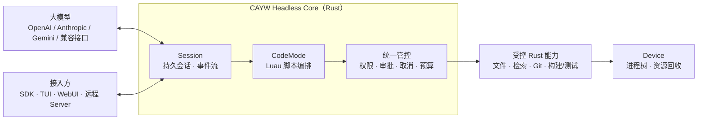

<div align="center">

# CAYW

**Code As Your Wish — 让模型写代码来调用工具的开源 Agent 运行时**

*An open-source, Rust-native agent runtime where the model orchestrates tools by writing code, not by calling them one by one.*


</div>

> [!IMPORTANT]
> **首发面向 macOS，已能离线运行“模型输出 → Luau → 受控工具”的持久化运行链。** 当前 workspace 有 20 个 Rust 包，包含 Core、Runtime/IPC、Luau/Cells、Host、Device，以及界面和可选组件。[Issue #1 的独立 SDK/IPC 客户端与取消修复](docs/validation/issue1-sdk-ipc.md)已完成 macOS ARM64 首发范围的本地验收，完整默认测试通过，GitHub #1 已按用户要求关闭。Windows、Linux 后续支持由 [#19](https://github.com/changw98ic/CAYW/issues/19) 单独跟踪，不阻塞首发；其余任务和持久化 Runtime 真实模型验收继续推进。
>
> The first release targets macOS only. The persistent Rust runtime can execute offline model fixtures through Luau and authorized Host capabilities. Issue #1's independent SDK/IPC client and cancellation repair have passed local acceptance on macOS ARM64, including the default workspace suite. GitHub #1 is closed at the user's request; its implementation and independent client are delivered together on the `pi-core-rust` branch. Linux and Windows support is tracked separately in #19 and does not block this release. Earlier live Magpie + DeepSeek Flash results cover the original agent core, not the current persistent runtime.

## 一句话说明

CAYW 是让 AI Agent 通过短段 Luau 代码编排工具的**开源 Rust 运行时**：接入模型，由宿主决定能读写哪些文件、调用哪些服务、运行哪些构建或测试，并保存每次授权和执行结果。遇到无法确认的副作用时停止，核对原记录后再恢复。

SDK、终端界面、网页和自动化流程都可以接到同一个**无界面运行时**上。普通对话可独立运行，可选模块按需接入。

## 现在可以运行什么

最初的模型与工具循环参考 [pi](https://github.com/earendil-works/pi) 的 `pi-ai` / `pi-agent-core` 1.3.0 独立编写，后续运行层由本仓库实现。当前实现按职责分为：

| 组件 | 已有实现与范围 |
| --- | --- |
| `cayw-ai` / `cayw-agent` | 消息与流事件、严格参数校验、多轮模型/工具循环、取消和回调；早期有限真实模型测试单独记录 |
| `cayw-core` / `cayw-runtime` / `cayw-ipc` | 持久会话、事件游标、原执行者身份、Rust SDK 和本地 IPC；未知结果核对后恢复 |
| `cayw-codemode` / `cayw-cells` | 有内存、调用次数和输出限制的 Luau，分段执行/等待、独立调用记录与恢复核对 |
| `cayw-host` / `cayw-workspace` / `cayw-data` | 授权后执行文件读写、正则/通配检索、Rust 单文件大纲、diff 定位、变更批次、归档读取及固定 Git/构建/测试能力 |
| `cayw-device` / `cayw-requests` / `cayw-bridge` | 进程资源归属和清理、任务能力申请、宿主已有 MCP/Skills 的按需接入；各自完整验收仍有缺口 |
| Provider、模块、内容存放、远程与 TUI/WebUI | 已有包和局部实现；实际边界以各包说明及验收记录为准，不能据包名认定全部功能已完成 |

需要 Rust 1.95+。离线示例不需要 API Key，也不访问模型服务：

```sh
cargo run -p cayw-agent --example offline
```

示例实际执行 Rust 加法工具，输出：

```text
tool start: add {"a":2,"b":3}
tool result: 5
assistant: 2 + 3 = 5
completed: 5 messages, running=false
```

上面的离线示例使用固定模型数据；HTTP 适配另有本地服务的完整往返测试。另已通过 Magpie + DS Flash 完成 4 项真实检查，实际响应模型为 `deepseek-v4.1-flash`：流式文本、Rust 工具调用后回答、下一轮记住工具值、收到文本后的取消。真实入口是 `cargo run -p cayw-agent --example magpie --locked`，需显式设置 `MAGPIE_API_KEY`；会发送真实请求，可能计费，不属于普通测试。

开发与验证命令见 [AGENTS.md](AGENTS.md)，原始内核接口见 [内核说明](docs/rust-pi-core.md)，新增读取能力见 [Workspace 说明](crates/cayw-workspace/README.md)。[早期离线验收](docs/validation/rust-pi-core.md)、[有限真实模型记录](docs/validation/rust-pi-core-magpie.md)、[Core 修复验收](docs/validation/core-boundary-repairs.md)、[Runtime 宿主接入](docs/validation/runtime-bridge.md)、[SDK / IPC 早期离线验证](docs/validation/sdk-ipc-harness.md)、[Issue #1 客户端与取消修复验收](docs/validation/issue1-sdk-ipc.md)、[diff 文件结束标记修复](docs/validation/workspace-diff-eof.md)、[共享读取接线复核](docs/validation/shared-read-runtime.md)、[Device 交互进程验证](docs/validation/device-interactive-process.md) 和 [网页本地运行验证](docs/validation/webui-runtime.md) 分别记录自己的源码和范围；这些结果只覆盖各自记录的 macOS 架构、源码和场景，不能代替最新组合或全部 Issue 的验收，也不提供普遍的性能或模型质量结论。

## 为什么要做

CAYW 希望改善编程 Agent 的这些使用方式：

| 常见做法 | 带来的问题 | CAYW 的做法 |
| --- | --- | --- |
| 模型一次调用一个工具，每步都要来回一轮 | 慢、费 token，多步任务容易中途走偏 | **CodeMode**：模型写一小段 Luau 脚本，一次编排多个工具调用 |
| 直接给模型一个 Shell | 权限无边界，跑出去的进程管不住、停不下 | 默认**不给 Shell**，只提供预置的受控能力；真需要时按任务申请、限定范围 |
| 会话和执行绑死在一个进程里 | 崩溃或断线后无法安全恢复，可能重复执行有副作用的操作 | **会话与执行者分离**；恢复前先核对“不确定是否已执行”的操作，不盲目重放 |

## 它怎么工作

下面是运行时的职责划分。图中已有实现与后续目标并存，具体交付和验证范围见上表及开发路线图。



模型可以在一段 Luau 中调用多项能力。下面使用当前真实接口，查找 Rust 文件、搜索函数声明并返回匹配结果：

```lua
local files = cayw.call('fs.glob', {
  path = '.', pattern = '**/*.rs'
})
local matches = cayw.call('fs.grep', {
  path = '.', pattern = '^pub fn', multiline = true,
  max_matches = 20
})
return { files = files, matches = matches }
```

每个 `cayw.call` 都独立经过 Host 的参数校验、授权、调用记录和预算检查。出现未授权调用时等待审批或返回拒绝，不因脚本已经获准而放行内部操作。Luau 到 Host 的执行链及共享读取已有离线集成与独立复核；共享读取仍为每次原调用保留独立授权、预算和终态。完整 CodeMode 能力集与最新组合验收继续补齐。

## 设计原则

- **Headless 优先**：内核单独就能跑完整的多轮对话和工具执行，界面、远程服务、工作流都是可选插件。
- **AI Native**：工具接口为“模型写代码来用”而设计，而不是为人点按钮设计。
- **默认最小权限**：不向 Agent 暴露 Bash / Shell / Node / Python 通用入口，缺什么能力按任务申请。
- **可恢复、可取消**：取消后继续核对原执行结果和资源清理；持久化恢复已有实现，未知副作用不会自动重放。清理或记录失败时保留停止状态。
- **模型无关**：逐个接入 OpenAI、Anthropic、Gemini 及兼容接口，只标注实际验证过的能力。
- **不依赖 Codex**：CAYW 是 [WinWinCode](https://github.com/changw98ic/winwincode) 与 [CodePatchBay](https://github.com/changw98ic/codepatchbay) 的后续方向，目标是完全替换它们对 Codex 内核的依赖。

## 模块一览

| 模块 | 作用 | 必需？ |
| --- | --- | --- |
| Headless Core | 会话、事件、CodeMode、权限与调度 | 必需 |
| Device | 管理本机执行进程、资源与内容存放 | 必需 |
| SDK / IPC | 供外部程序接入的公开接口 | 必需 |
| TUI / WebUI | 终端界面 / 网页界面，可单独安装 | 可选 |
| Server | 远程接入；设备只需主动连出，不开放端口 | 可选 |
| StrongFlow / JEv / Fusion / Observer | 强流程、扩展与诊断模块，可插拔 | 可选 |

## 路线图

| 阶段 | 目标 | 状态 |
| --- | --- | --- |
| 前置内核 | 参考 pi 的 Rust 消息、模型流与工具循环 | 原型已实现；macOS 上有限 Magpie + DS Flash 检查通过 |
| A | 最小 SDK 与 IPC、macOS 验证基线、Luau CodeMode 原型、最小进程管理 | #1 已完成 macOS ARM64 首发范围的本地验收；验证底座及其他交付继续推进 |
| B | 只用内核跑通第一个真实的流式多轮对话 + 工具执行 | 离线运行链已有；当前持久化 Runtime 真实模型验收待补 |
| C | 崩溃恢复、按需权限申请、MCP / Skills 接入、多模型、多会话并发 | 已有实现；组合故障、真实服务和并发验收继续推进 |
| D | 模块接口、TUI、WebUI、远程 Server、可插拔扩展 | 已有包与局部实现；统一进程清理、两机等验收待补 |
| E | CPU / 内存 / GPU 资源策略与内容存放、可选加密同步 | 部分本地存放/资源记账已有；硬限制和远程同步未完成 |

完整的 19 个任务（原 18 项加 Linux/Windows 后续支持 #19）、依赖关系和验收标准见 [开发路线图](docs/development-map.md)。

## 参与

项目还在早期，现在最有价值的参与方式是：

- 在 [Issues](https://github.com/changw98ic/CAYW/issues) 里讨论设计、指出问题或补充验收场景；
- 首发只面向 macOS；#1 的公开 Rust SDK/IPC、独立客户端、事件续订、审批与取消、工具结果配对和同一会话重开恢复已完成 [macOS ARM64 本地验收](docs/validation/issue1-sdk-ipc.md)。接下来推进 #2 的 macOS 验证基线，继续按 #1 → #2 → #3/#4 → #5 夯实验证、Luau、进程清理和预置工具，再完成 #6 的真实模型、权限、持久化与取消全链。共享读取与 Device 交互进程已分别验证；External Module 统一进程清理的独立交付仍有测试失败，长会话读取优化已交回但尚未接主树。有限真实模型或局部测试不代表这些 Issue 已完整验收。

**给 AI 编程助手：** 在本仓库工作前请先读 [`AGENTS.md`](AGENTS.md) 和 [`docs/development-map.md`](docs/development-map.md)。

## 许可证

[Apache License 2.0](LICENSE)
