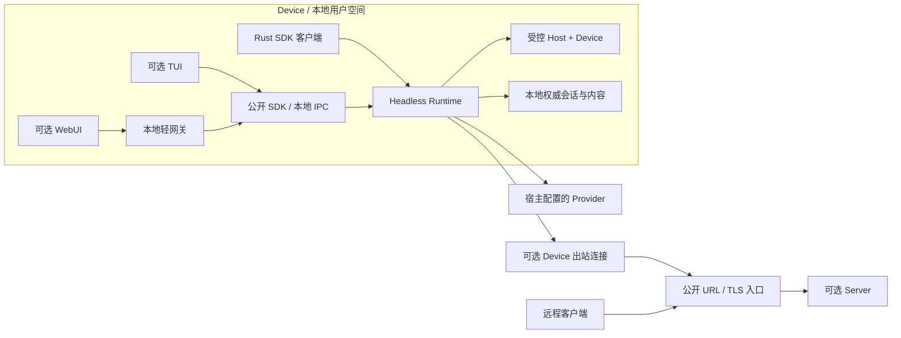
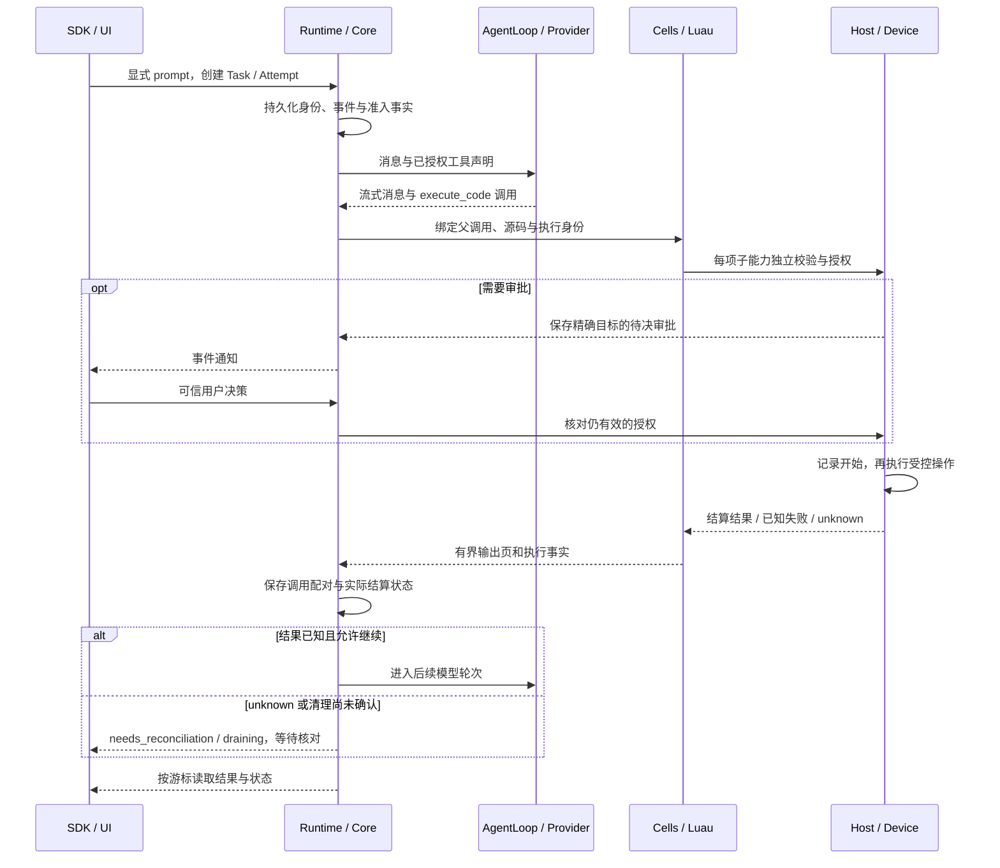

# CAYW 架构

[项目说明](../README.md) · [开发路线图](development-map.md) · [SDK / IPC 契约](issue1-sdk-ipc-contract.md)

## 文档范围与当前状态

CAYW 定位为 Rust 原生、模块化的 **Agent OS kernel**：这是用户空间的 Agent 运行基础设施，负责模型循环、工具编排、会话状态、执行归属和恢复。这里的 kernel 描述 Agent 的共同运行底座，不包含操作系统内核、驱动或硬件虚拟化承诺。

本文连接已有实现与目标架构。2026-10-27 的本地集成以 `dev` 的 `9cc509d` 为基底，更新统一结果、共享文件版本、任务、观测和可选工作台的职责。它不是新的 Issue 验收报告。实际命令、源码差异和通过范围记录在对应验收文件中。

“当前/已有”表示已核对的源码或历史证据；“目标/必须/不能”等描述架构约束，不自动表示对应实现已完成。尚未完整验收的能力以表中缺口和对应 Issue 为准。

| 领域 | 已有实现或证据 | 尚未据此完成的交付 |
| --- | --- | --- |
| 模型与 Agent 循环 | `cayw-ai`、`cayw-agent` 有内存循环、离线/本地 HTTP 用例及早期有限真实模型记录 | 早期真实模型记录不覆盖当前持久化 Runtime 全链；[#6](https://github.com/changw98ic/CAYW/issues/6) 仍未验收 |
| Core、公开 SDK、本地 IPC | [#1](https://github.com/changw98ic/CAYW/issues/1) 已完成 macOS ARM64、固定离线模型的本地功能验收并关闭，实现已合入主树 | 不等于全部 feature、其他 macOS 架构或真实 Provider 全链验收 |
| Luau、Cells、Host、Device、Requests、Bridge | 已有代码和局部离线集成；共享读取与 Device 交互进程有各自验证记录 | 预置能力全集、组合故障和各 Issue 的完整验收仍需补齐 |
| UI、plugin、远程与内容库 | 已有包和局部实现，不是空架构 | External plugin 统一进程清理的独立交付仍有失败；远程两机、完整资源硬限制和真实加密同步等未完整验收 |
| 平台 | 当前首发仅面向 macOS，已有执行证据覆盖 macOS ARM64 | Linux/Windows 由 [#19](https://github.com/changw98ic/CAYW/issues/19) 后续跟踪；现在不开展适配、探针或验证，也不阻塞首发 |

最新验收范围以 [Issue #1 验收记录](validation/issue1-sdk-ipc.md)、[路线图](development-map.md) 与对应任务为准。已有代码不能继续写成“全部未实现”，包名、示例或历史测试也不能作为全部功能通过的证据。

## 目标与非目标

目标是提供可独立嵌入的 Headless Core：通过 API 完成流式多轮 Chat、统一工具执行、审批、取消、持久化和核对后恢复。Session 与可更换执行者解耦；同一底座服务 SDK、TUI、WebUI、远程接入和可选工作流。首个真实闭环先落实一个协议，再逐步扩大 Provider 支持。

Core Only 的完整真实模型闭环是 [#6](https://github.com/changw98ic/CAYW/issues/6) 的目标，需先夯实 Rust pi 内核和 Stage A 的 SDK/IPC、验证、Luau、Device、预置 CodeMode 能力。当前离线实现与有限原型不替代该验收。审批只建设满足主链的必要能力，不先叠加通用框架；身份、权限、调用配对、幂等、取消和预算是必需约束。

本架构不要求先部署 UI、Server、VerifyTool 或 plugin，不承诺所有协议、设备和存放档位一次完成，不引入重复 loader、重型内核索引或无约束 Shell。最终运行和依赖不包含 Codex；普通开源依赖允许。可借鉴 WinWinCode/CodePatchBay 的设计与适配经验，代码和许可证不自动继承。项目继续使用 [Apache License 2.0](../LICENSE)。

## 组件职责与依赖方向

“Headless Core”是产品能力边界，不等同于单个 `cayw-core` crate。`cayw-core` 保存持久事实和状态契约，`cayw-runtime` 将它与 Agent、Cells、Host 等组合成公开运行入口。根 [Cargo.toml](../Cargo.toml) 是实际包与依赖的依据。

| 组件 | 职责 | 依赖与边界 |
| --- | --- | --- |
| `cayw-ai` / `cayw-providers` | 消息、模型请求/流事件、参数声明与协议适配 | 不负责设备权限、Session 权威状态或 UI |
| `cayw-agent` | AgentLoop：历史、模型流、工具批次、steering/follow-up、取消 | 消费 Provider 与宿主注册工具；自身历史在内存中，不冒充持久化 Runtime |
| `cayw-core` | Session、Attempt lease、事件日志、执行/调用/审批事实与核对 | 对执行写入检查完整 lease；不加载 UI、Server 或外部代码索引 |
| `cayw-runtime` / `cayw-ipc` | 公开 Rust 入口、调度与生命周期协调；本地传输 | 复用同一 Runtime 分派，不另建 IPC 专用执行器 |
| `cayw-codemode` / `cayw-cells` | Luau 编排、分段 cell、输出、会话值、执行记录与共享读协调 | 通过宿主能力接口调用 Rust，不自带环境文件/进程/网络权限 |
| `cayw-host` / `cayw-workspace` / `cayw-data` | 授权、审计和预算后分派文件、检索、数据、Git 与配置好的进程能力 | Workspace/Data 执行器本身不是模型权限边界，不能另作旁路暴露 |
| `cayw-device` | 进程树归属、交互进程、停止确认、资源记账和准入底座 | 本地执行不依赖远程 Server；进程组不是安全沙箱 |
| `cayw-requests` | 长尾能力申请、可信评估、精确任务授权与撤销 | 申请本身不执行、不自授权；仍经过原 Host/Device |
| `cayw-bridge` | 宿主已有 MCP/Skills/搜索能力的目录、来源快照和调用桥接 | 不在 Core 再创建连接或 loader |
| `cayw-plugins` / `cayw-content` / `cayw-remote` | plugin、Device 内容存放/备份、远程绑定路由 | 各自边界与局部实现分开验收；不成为普通 Chat 的强依赖 |
| `cayw-tui` / `cayw-webui` / `cayw-verify-tool` | 客户端、浏览器轻网关与验证消费者 | 依赖公开接口；Runtime 不反向依赖这些消费者 |
| `cayw-visual-editor` | HTML/CSS、Vite React 与 Vue 3 页面的可选编辑应用；源码映射、预览和直接操作 | Rust 持有草稿与源码权威，保存通过 Host 公开接口执行文件权限、调用记录和摘要核对；可选 Node 进程解析 JSX/TSX/SFC 并启动 Vite，Core 不依赖编辑器 |
| `cayw-codeintel` | 工作区相对路径、内容摘要、文件版本与符号位置 | Host、Editor 与 Trace 可注入同一个进程内共享实例；轻量大纲不等于完整跨文件语义索引 |
| `cayw-output-filter` | 固定进程 profile 的显示过滤与原文引用 | 原文通过宿主注入的内容接口保存；过滤不改变进程实际终态 |
| `cayw-context` / `cayw-run-inspector` | 从模型请求账本、Core 事件生成上下文和运行过程视图 | 派生展示，不另建执行权威或伪造缺失费用 |
| `cayw-panel` / `cayw-plannotator` / `cayw-artifacts` | 面板登记、带来源的批注与产物动作 | 界面通过公开 Runtime 接口提交动作；批注不成为授权 |
| `cayw-web-access` / `cayw-vision` | 宿主显式启用的网页与图像能力 | 调用沿原 Host 权限和预算执行；存储由宿主注入，不反向依赖 Runtime |
| `cayw-pi-compat` | 可选外部扩展适配 | 与 Runtime 共用 plugin 目录和 Bridge；Node 只用于显式启用的适配器，当前 npm 范围限于固定版本的 hello 工具 |

依赖从接入方指向公开接口，再由 Runtime 组合运行底座。Host 实现 CodeMode 的能力接口，Runtime 注入实际实现；接口调用不要求 CodeMode 反向依赖具体 UI 或某个 MCP 客户端。可选 Native plugin 由 Cargo feature 决定编译组合，External plugin 由宿主通过 IPC 注入。模型响应中的工具或 plugin 名称不能新增依赖或授予权限。

本地 Agent 循环依赖 Provider，并不依赖 TUI、Server 或 VerifyTool。VerifyTool 可以依赖真实 Runtime 做验证，这不形成 Runtime 对 VerifyTool 的反向依赖。运行数据会往返流动，但不改变这些软件依赖方向。

可视化编辑器按 `--framework` 显式选择 HTML、React 或 Vue。HTML 使用 Rust 解析与静态预览；React/Vue 的 Node 进程保留项目 Vite 配置和插件，分别提供磁盘原页面与内存草稿预览。Node 只返回有界的源码补丁，Rust 校验文件、UTF-8 字节位置和旧文本后提交草稿。普通编辑不调用模型，也不向模型增加通用 Node 工具。项目 Vite 配置以本机用户身份执行，进程隔离不是沙箱。多文件保存逐个核对文件摘要，不承诺跨文件事务；中途仅保存部分文件时，保留持久未知状态并停止后续写入。

## 部署形态

| 形态 | 必需组成 | 可选接入 | 权威内容与限制 |
| --- | --- | --- | --- |
| Core Only | Runtime、持久化 Core、Agent/Provider、Cells/CodeMode、宿主受控能力及所需 Device 底座 | 独立 Rust API 客户端；需要进程边界时使用本地 IPC | 不需要 UI/Server/VerifyTool/工作流；Provider 可由宿主注入，真实模型使用另行授权 |
| Local | 同一台设备上的 Core Only | TUI；WebUI + 本地轻网关 | Device 保持权威内容；本地轻网关不依赖可选远程 Server |
| Remote | Device 上的同一运行底座，外加远程绑定与路由 | 远端 Server、客户端及 TLS 代理 | Device 主动连出，无需对外入站端口；Server 不因转发任务而取得执行或内容权威 |

以下是部署与数据流图，不是每个节点都已完成验收的声明。

Core Only 是可嵌入库的组合，不要求每个 crate 都成为独立进程。Worker 也不必一一对应操作系统进程。图中的本地 IPC/网关监听与 Device 不开放公网入站端口并不冲突。

## 身份、归属与生命周期

| 身份 | 含义与生命周期 | 不可混用的标识 |
| --- | --- | --- |
| Session | 持久对话、历史、游标、待处理义务与来源关系；可以跨进程退出继续存在 | 不等于一次模型请求、Worker 或 PID |
| Task | 一次显式 prompt/任务准入，绑定 Session、意图、队列与预算 | 断线续读不是新 Task；重新提交可能产生新副作用 |
| Attempt | Task 的一次受围栏执行；lease 含 `session_id/attempt_id/worker_id/fence` | 旧 attempt 不能更新新执行，fence 必须随接管推进 |
| Worker | 可替换执行者的逻辑身份 | 不把 PID 当稳定身份，进程需另外绑定启动身份 |
| Execution / cell | 一段确切编排源码，绑定 Task、Attempt、父模型调用和源码 hash | `cell_id` 不是任意 Session 可用的句柄 |
| 模型工具调用 / 子能力调用 | 父调用 ID 配对模型 tool result；子调用另有 execution + sequence、实参、授权和终态 | 子能力成功不能被另一条模型调用或 wait 收据顶替 |
| IPC / 远程 request | 一条连接或协议范围内的请求关联与回执 | 不等于 Session 事件游标，也不是自动重放许可 |

Session 当前有 idle、running、awaiting_approval、needs_reconciliation 等状态；StrongFlow plugin 缺失的冻结是额外约束，不应伪装成成功结束。Session idle 表示可继续对话，不是整个会话永久终结。Task、调用、执行和审批的终态不能被之后的新任务改写。

Task 队列区分 queued、running、draining 与 completed/failed/cancelled/interrupted/outcome_unknown。draining 表示工作已停止准入，但清理或持久化仍需核对；不能提前释放执行容量。运行身份和完整 lease 在与执行写入相同的事务内核对。恢复要先确认原执行者停止并取得独占归属，不能只凭一次“进程不在”的观察接管。

依据：[Core 类型](../crates/cayw-core/src/types.rs)、[Runtime 队列](../crates/cayw-runtime/src/queue.rs)、[SDK/IPC 身份契约](issue1-sdk-ipc-contract.md)。

## AgentLoop、ModelPort 与上下文

AgentLoop 是模型请求、流式响应、工具执行和下一轮请求的共同循环；当前由 `cayw-agent::Agent` 承担。本文的 ModelPort 是协议适配职责名，现有对应接口是 `cayw_ai::Provider`，不表示仓库另有同名 trait 或第二套模型框架。

Provider 接收明确的模型请求和取消令牌，返回文本、思考、工具调用等流事件以及确定的结束或错误。当前 OpenAI 适配及其他适配器的实际范围以源码/各包说明为准；“兼容接口”不能替代逐项能力验证。流截断、参数无效、重复调用编号或错误结束不能被当成可执行工具意图。

工具声明和 Schema 由宿主注入。Agent 对参数严格校验，工具结果按原调用配对，批次历史保持调用顺序；并行执行策略不能破坏这一历史。Messages 适配器在响应完整、调用编号唯一且工具已声明时，将参数错误交给 Agent 生成“未执行”的错误结果，允许模型在原轮数、取消和预算限制内修正。原始无效参数仍保留在历史与协议元数据中；下一轮只为传输生成明确标记无效参数的对象，必须与同一调用的已知错误结果配对。断流、截断、身份错误及未知效果仍停止，不自动重放业务调用。宿主可排入 steering/follow-up，但不能因此跳过尚未结算的调用。最终工具结果进入下一次 Provider 请求，过程输出则通过带来源的事件供客户端消费。

Agent 的内存历史由 Runtime 与持久记录衔接。上下文包含消息、已配对工具结果、显式系统/能力说明及本轮选取的技能内容；不默认把所有 Skills、Schema 或代码库灌入每轮。长会话读取优化、裁剪/摘要策略仍需验证，不得为缩短上下文丢弃调用配对、原始执行证据或未知状态。依赖快照冻结的是执行读取依据，不等同完整对话快照或冻结外部文件系统。

早期有限 Magpie 记录仅证明原始 Agent 循环的相应场景；当前持久化模型全链、协议兼容矩阵与模型真实任务成本分别按 [#6](https://github.com/changw98ic/CAYW/issues/6)、[#10](https://github.com/changw98ic/CAYW/issues/10) 验收。参见[原始内核说明](rust-pi-core.md)、[Provider 代码](../crates/cayw-ai/src/providers/openai.rs)和[适配器边界](../crates/cayw-providers/README.md)。

## 一轮持久执行

下图说明目标主链与当前实现共同遵循的结算顺序；不代表 #6 真实 Provider 全链已经通过。

执行前拒绝、确定未执行、已知失败、成功、结果未知是不同事实。输出转换/展示失败不能抹去已发生的 Host 成功；预算耗尽也不能把未知效果改成普通失败。需要核对时，主链停止新副作用，保留原调用、执行身份和可用回执。

## CodeMode：Luau 优先与 Rust 能力底座

Luau 是当前优先方向，已有运行时；Monty 只作可选同契约比较，不阻塞 [#3](https://github.com/changw98ic/CAYW/issues/3) 与 [#5](https://github.com/changw98ic/CAYW/issues/5) 主线。不存在凭语言选择给出的“最快”保证。常规编码需求优先由预置、受控的 Rust 能力覆盖。

模型可见入口统一为 `execute_code`。`cayw-codemode::CodeModeTool` 是直接执行适配；持久化 Runtime 使用 Cells 的 `CellTool`，不能再同时注册另一个同名入口。Luau 通过 `cayw.call` 调用 Host，不直接取得环境文件系统、网络或任意进程权限。一次脚本被接纳不等于内部所有调用获准。

### cell、exec / wait 与跨单元状态

| 原语 | 语义与边界 |
| --- | --- |
| `exec` / `cell_id` | 当前在 `execute_code` 的 `action: exec` 中创建执行单元；保存原源码/hash、父调用与不可由模型伪造的身份 |
| `wait` / cursor | 读取同一 cell 的增量输出并按需继续让出的活 VM；不重新执行原脚本，不把它当新工具效果 |
| `yield_time_ms` | 控制本次返回/等待窗口；窗口结束不等于取消整个受管执行，也不重置总预算 |
| `yield_control` | 让出活执行，待显式 wait 继续；进程退出后不能借 wait 复活原 Luau 栈 |
| `store` / `load` | 会话级有界值存取及版本冲突检查，跨 cell 共享；不是保存任意 VM/进程对象，也不是新的授权来源 |
| `ALL_TOOLS` / `toolDefinition` / `tool_search` | 按需目录与 Schema 自省；目录可见性和执行授权分别检查 |
| `text` / `image` / `audio` / `notify` / `exit` | 类型化、有界、带游标的输出与退出；媒体 MIME/编码和体积需校验，notify 是进度元数据 |

`max_output_tokens` 是现有 API 字段名，Cells 当前按保守的**序列化 UTF-8 字节预算**计费，不是 Provider tokenizer 或媒体 token 估算。页预算不足以容纳下一项时保留游标并报告所需预算，不能静默跳过输出。文本、媒体和 JSON 输出支持也不等于每个 Provider 都能接收相同多模态格式；UI 呈现与模型协议支持分别核对。

重启可恢复 cell 记录、输出、会话值和子调用事实，不能恢复已经丢失的 Lua 栈。明确未执行的调用、已结算调用和未知调用分别处理；丢失的 VM 不自动重跑源码，即使没有未知调用，也只能记录中断并由宿主决定后续新执行。

依据：[CodeMode 边界](../crates/cayw-codemode/README.md)、[CellTool](../crates/cayw-cells/src/tool.rs)、[Cells 类型与输出](../crates/cayw-cells/src/types.rs)。

### 依赖快照与共享只读

宿主给只读调用提供确切依赖版本、指纹和权限上下文，冻结该次读取依据；外部目录还保留来源实例、代际和 manifest 摘要。只有能力、参数、权限和依赖都匹配且策略声明可共享的读取，才可合并在途执行或复用已验证结果。当前 Runtime 的共享读取已有 fs.read 接线和独立复核，不代表所有只读能力都已支持共享。

每个原调用仍独立授权、扣预算、记录原始身份和终态，不能让缓存命中成为绕过审批/撤销的通道。写入、版本变化或权限/来源失效后不能使用旧快照的结果。只读优化不合并有副作用的操作，也不能把 unknown 包装成缓存成功。可推广能力集合、共享者取消策略和长会话优化以实际实现及后续验证为准。

依据：[共享读取验证](validation/shared-read-runtime.md)、[Cells 缓存](../crates/cayw-cells/src/cache.rs)、[Bridge 来源快照](../crates/cayw-bridge/src/model.rs)。

### 统一结果与原文读取

`result.store/get/batch_get/search/release` 是 Runtime 的统一结果入口。内容由 Device 的 `cayw-content` 保存，引用同时携带会话、可选任务、内容摘要、大小与编码。读取继续核对原作用域和权限。释放只改变可读状态，目前不回收物理内容，也不返还内容配额。

进程过滤保留 stdout、stderr 的正式原文引用。结果外置与显示转换发生在原 Host 调用结算之后。转换失败不能把实际成功改写成未执行，也不能成为自动重放理由。

### 共享文件版本与观测

`cayw-codeintel` 以工作区相对路径和内容摘要发布单调文件版本，符号位置绑定对应版本。Host、Editor 与 Trace 可注入同一进程内的实例。Editor 成功保存后发布新版本；索引失败不会反向改写已完成的磁盘保存。独立进程需要自己的明确接入，不能把 `Arc` 描述为跨进程共享。

上下文视图复用模型请求账本。运行过程视图复用 Core 与 Agent 事件。缺少价格依据时费用显示未知。不同入口的分页游标各有作用域，Trace 本地记录位置不等于 Session 事件游标。

### 预置能力与受控进程

[#5](https://github.com/changw98ic/CAYW/issues/5) 的目标能力集包括文件与变更批次、检索/结构化定位、数据处理与编码、结构化 Git、构建/测试/检查/格式化、交互进程、人机澄清与宿主协作。它是交付范围，不意味着这些能力已经全部注册或验收。

当前 Host 按配置提供目录：固定文件/数据/Workspace 能力已有实现；Git、构建/测试等仅在宿主配置相应可执行路径或精确 profile 后出现。Workspace 有界文本检索与 Rust 单文件语法大纲不等于完整语义索引。变更批次有恢复日志，不承诺多文件在同一时刻原子可见；完整 Git 写操作等按任务范围继续验收。

受控 `exec_command` / `write_stdin` 与交互会话可以服务项目构建、测试和其他已授权需求，但必须绑定 Host 选择的程序/参数/环境、工作区、Device 进程归属与 `terminal_handoffs` 等生命周期约束。默认禁用的是无约束 Bash/Shell/Node/Python 或任意进程旁路，不是禁止使用正常项目工具链。不能让命令文本或模型字段替代宿主授权。当前支持与限制参见 [Host](../crates/cayw-host/README.md)、[Workspace](../crates/cayw-workspace/README.md)及[交互进程验证](validation/device-interactive-process.md)。

## 权限申请、审批、取消与预算

普通已配置能力经原 Host gate 执行。真实长尾缺口才进入 [#8](https://github.com/changw98ic/CAYW/issues/8) 的按需 ReAct 申请：说明用途、能力缺口、操作和确切范围；可信宿主核对，不接受模型自报的批准、actor 或有效权限。

首次有效申请即可由可信宿主评估。重复次数只提示同一能力缺口是否反复出现，不决定评估资格，也不自动授权。宿主可记录用户明确的项目测试或脚本意图，模型自己声明不能代替。普通任务不因没有提交申请而消耗终身申请额度；申请任务已知结束后释放活动准入额度，保留原审计和授权失效记录。可信宿主可以调整申请运行限额，不能借调额清除历史未知。当前 Runtime 的调额会持久记录并更新该实例共用的申请句柄；该实例的克隆可以继续使用同一份额度，活动任务也可继续。另一个独立 Runtime 打开时，调额在写入前拒绝，防止其继续使用旧额度。全部 Runtime 关闭后，宿主也可通过管理入口或下次启动配置调整，原任务、事件和决定保持不变。评估不可用、拒绝或超时不应阻塞无关的普通已授权工具。

授权限定于 Session/Task/Attempt、目标能力、参数、profile、权限策略与期限。它只能使用底层已经允许的资源，不能增加文件根、程序、参数、服务连接或 Device 权限。审批针对精确父工具调用或子能力调用，记录可信决策者和依据，迟到许可不能复活已取消任务。详见 [Requests](../crates/cayw-requests/README.md)与[Runtime 权限](../crates/cayw-runtime/src/permissions.rs)。

取消沿 Task、Agent、cell、Host、Device/External 传播。取消请求、停止准入、实际停止、记录终态和清理完成是不同事实。未来新调用必须被围栏，已开始效果仍需结算/核对。清理失败时保持 draining 与原容量，持久化失败时不承认相冲突的完成；取消不能清空 unknown。完成和取消按持久队列事务定序：先提交的完成不能被之后的取消改写，先提交的取消不能被迟到成功覆盖。

预算贯穿轮次、并发/队列、调用次数、时间、输出、内存和进程生命周期。yield/wait、重连、重新审批或能力申请不能重新获得整份预算。可信宿主可以明确提高会话树的模型额度；已消费和未知预留继续占用，新 Task、子会话、Fork 或重开本身不增加额度。确定尚未派发的取消，可在持久记录确认后释放该请求未用预留；可能已派发的未知费用继续保留。作用域以真实 Task 和执行归属为准，UI 不能凭展示状态释放名额。安全停止且无活动或清理待核对任务后，可信宿主可以调整调度和资源配置，并存实例不能按不一致策略准入。复杂 CPU/GPU 硬治理按 #18 后续推进，不以尚未完成的机制冒充当前硬限制。

## MCP、Skills 与外部检索

宿主统一持有 MCP 连接和 Skills loader，Core 只消费被注入的目录与能力桥。发现名称、读取 Schema/Skill、执行调用是独立权限操作；发现结果和 Skill 文本均不授予执行权限。

Bridge 保存来源 ID、版本、origin、实例/代际、manifest 摘要和原调用关联。来源卸载/替换后，旧快照或迟到结果不能装作当前来源；已开始但未获可靠回执的调用保持 unknown。模型不能通过一个看似相同的工具名改绑连接或伪造来源。

CodeGraph、跨文件 AST/语义索引和外部 search 在宿主侧按需接入，不塞进 Core。已有 Workspace 文本检索和单文件语法能力可直接提供受控局部读，但不替代这些外部服务。普通 Chat 不应因缺少某项检索扩展而失去基本运行能力。参见 [Bridge](../crates/cayw-bridge/src/registry.rs)、[Runtime 桥接验收](validation/runtime-bridge.md)和 [#9](https://github.com/changw98ic/CAYW/issues/9)。

## 持久化、事件游标、幂等与恢复

当前权威 Session 存储是 SQLite，Core 协议/存储为 **v3**，本地 IPC 帧为 **v1**；不同层版本不强行统一。#1 最早评论中的 JSONL、Unix socket/命名管道草案已由当前 SQLite 和认证 loopback TCP 实现取代，不再并建旧路径。

Session 事件追加记录并与其状态投影一起提交，保存原 lease 和严格递增游标。`events(after, limit)` 排除 after；消费者持久保存最后连续处理的游标，再在新连接显式读取后缀。Cell 输出游标和 IPC 请求 ID 各有自己的范围，不能互换。事件订阅断开可以续读，不能据此重发原 prompt。当前持有活动 prompt 的 IPC 连接丢失会触发该调用的取消/未知结算，单独的事件连接断开则不等于重新提交任务。

调用记录保留源码/hash、精确参数、父调用、子序号、Task/Attempt、授权、来源与结算。幂等是对同一身份和输入的重复/迟到操作做拒绝或返回既有事实；不承诺跨外部系统的 exactly-once。数据库和执行日志需要一致，但不能仅因都使用 SQLite 就宣称 Core、Requests、进程日志等跨组件事务天然原子；Runtime 需协调 closing/draining 和恢复围栏，失败时保留待核对事实。

| 发现的事实 | 恢复动作 |
| --- | --- |
| 原执行者仍在或无法取得独占归属 | 不接管，不启动重复执行 |
| 有证据证明尚未开始 | 记为 not-executed；后续重试必须是显式、重新检查授权的动作 |
| 已有可靠成功/失败收据 | 按原调用身份保存/核对既有结果，不重复副作用 |
| 操作可能执行但没有可靠终态 | 保持 outcome_unknown，冻结新副作用，等待可信宿主证据 |
| VM 已消失 | 保留 interrupted/核对状态与输出，不自动重跑源码 |
| 执行已停但进程清理/状态提交失败 | 保留 draining/容量与原归属，显式恢复后再释放 |

后台任务独立保存原执行者、根进程和已观察后代身份，以及自己的 Device 清理记录。父任务清理不能代替后台任务清理。失去执行者或持久化失败后保持未知结果，不自动重新执行。可信 Rust 宿主先通过 `background_confirm_cleanup` 用独立记录核对原身份，再通过 `background_recover` 显式结算结果；清理确认本身不证明命令成功或失败。

核对追加证据，不改写旧模型工具结果或原日志；对未知效果的核对不能用一个新调用伪装成原调用的成功。取消、重开、reset 或 Fork 都不能把 unknown 自动变成已知。具体协议、边界与复跑场景见 [SDK/IPC 契约](issue1-sdk-ipc-contract.md)、[Core 存储](../crates/cayw-core/src/store.rs)及 [#7](https://github.com/changw98ic/CAYW/issues/7)。

## Device、内容权威与资源

Device 管理执行进程、派生进程和交互会话，归属至少关联 Task、Attempt、Worker、启动身份与进程组。进程正常结束、取消、超时、宿主/Worker 退出均要确认原执行者退出和后代清理，再释放名额；Future Drop 或 PID 消失本身不证明外部效果撤销。

当前有进程/PTY 和资源记账实现，macOS 交互进程验证有单独范围。统一 External plugin 进程清理仍有独立失败，不能将 Device 局部通过外推到所有启动路径。进程组不等同安全沙箱；复杂 CPU/内存/GPU 准入和硬限制尚按 [#18](https://github.com/changw98ic/CAYW/issues/18) 推进。当前不开展 Linux/Windows 适配。

Device 持有会话、工作区与内容的权威事实。可信宿主可在安全停止后启用原先未启用的内容库，也可为同一原目录和 Device 增加配额；旧句柄和并存实例不能按冲突配置继续写入。目录身份、版本冲突和未知效果仍需核对。已有 `cayw-content` 提供本地内容和可选加密备份对象，但不等于远程同步已经验收。存放档位按需实现：本地独立运行先成立，再验证可选同步的密钥持有者、版本/冲突、撤销、读回校验与恢复。Server 不因保存中转对象而成为内容权威；远端失败不阻断本地权威读取。参见 [内容库边界](../crates/cayw-content/README.md)。

## 公开 SDK、版本 IPC 与消费者

公开 SDK 当前由 `cayw_runtime::Runtime`、`cayw_core::SessionStore` 等接口提供，独立客户端不能访问 Runtime 私有状态。本地 IPC 处理器消费同一组 Runtime 操作，包括会话创建、prompt、事件、审批、取消、任务查询与显式恢复/核对。实际对应关系以 [SDK/IPC 契约](issue1-sdk-ipc-contract.md)为准，不在本文发明另一套 API。

当前 `cayw-ipc` 是认证 loopback TCP、LF 分帧 JSON，外层版本 v1。先 hello 再业务分派；未知版本和错误认证明确拒绝，不自动降级。请求/响应和取消确认分别配对，帧、队列、在途数与期限均有界；断连、超时或协议失败后的在途请求可能结果未知，客户端先查持久事实，不自动重发。它不是远程 TLS 服务。

[#1](https://github.com/changw98ic/CAYW/issues/1) 的独立 SDK/IPC 客户端已交付，并验证离线事件续读、审批、取消、配对和恢复。公开接口要继续通过 TUI 与 VerifyTool 的真实消费、版本拒绝和兼容性用例验证；初版运行或编译全部 feature 不代表完整稳定性或全部组合执行完成。详见 [IPC 边界](../crates/cayw-ipc/README.md)、[独立客户端](../examples/issue1-client/README.md)。

## Native / External plugin、UI 贡献与 StrongFlow

可信 Native plugin 用 Cargo feature 静态链接，升级需重新编译；不承诺热替换 Rust ABI。External plugin 用独立进程、版本化 IPC，宿主限定启动配置、能力、权限、预算和生命周期。plugin manifest、版本/代际与调用关联必须可核对。独立进程并不防止恶意本地代码访问其进程已经拥有的资源，不能把进程隔离当成安全沙箱。

plugin 可贡献能力、状态、命令或供 UI 呈现的数据，但 UI 贡献不取得 Core 私有状态或新的执行权。TUI/WebUI 选择如何展示，用户动作仍经公开接口及原审批/权限路径；模型或 plugin 提供的“批准”只作为数据处理。不先加入新的 UI 框架，也不要求所有 plugin 实现某种界面。

普通 Chat 不依赖 StrongFlow/JEv/Fusion/Observer。StrongFlow Session 持久绑定流程版本、来源与义务：plugin 卸载或缺失时，原 Session 提示不可用并保持冻结，不在原地去掉义务或伪造完成。允许的转换是用户显式确认后，核对原执行已停止且没有未结未知效果，Fork 为新的普通 Session，保存来源会话/游标；原 Session 与证据保持原状，新会话重新获得自己的权限。

恢复 plugin 须核对原绑定、版本、实例/代际及兼容条件；重新加载同版本并不当然解冻。原 Session 恢复后仍按原流程继续，不能因 Fork 或 plugin 重载跳过验收。此处规定架构约束，不把现有 plugin 库、Runtime 接线和所有卸载/清理场景统称为已验收。

Observer 通过有界非阻塞诊断通道处理慢消费者与丢弃计数。它可以缺失，不能拦住已授权任务。执行授权、持久化和必要审计是主链事实，不能为了“诊断不阻塞”而跳过。JEv/Fusion 已有局部离线适配，结果/分歧不自动成为事实、审批或 StrongFlow 交付证据；真实服务、成本和产品集成按 [#17](https://github.com/changw98ic/CAYW/issues/17) 继续核验。

参见[plugin 边界](../crates/cayw-plugins/README.md)、[#12](https://github.com/changw98ic/CAYW/issues/12)与[#16](https://github.com/changw98ic/CAYW/issues/16)。

## Trace Debug：实时节点图与本地重新求值

`cayw-trace-debug` 是可独立启停的本机插件应用。它经认证 IPC 按 Session 游标消费事件，维护自己的追踪文件和网页，不直接读写 Core 或 Cells 数据库。Runtime 和普通无界面任务不依赖该包；没有安装插件时仍可正常执行。该接入不依赖 #30 的页面编辑器，也不要求启用其他 plugin feature。

节点适配用 `GraphPlan` 描述输入、初始状态、上下文、Luau 节点和分支边。实际 Runtime 执行通过普通有界输出产生带 `cayw.trace.v1` 标识的节点事实。Cells 保存输出后调用 `CellBackend::output`；Runtime 仅将这类输出发布为 `Host { kind: "trace_node" }`，保留原 execution、Task、父调用、源码摘要和输出游标。它是观测记录，不授予执行权限。原能力调用仍经过原有审批、预算、取消和结算。未提供节点适配的普通执行只显示已观察的调用事实，并列明不能局部求值的上下文缺口。

插件核对 `GraphPlan` 生成脚本与 Core 保存的源码校验值一致，并逐步核对节点顺序、分支、输入和进入前状态。节点代码不能自行发出保留格式的追踪事件；格式或路径不符时隔离该图，原始事件继续保存。网页只在原始运行中根据尚未结算的节点调用显示“等待响应”，不把历史结果或本地重放显示成等待。

编辑仅保存到插件内容版本。节点保存后，插件复用 `cayw-codemode::CodeMode`，从修改点进入前捕获的输入、状态和上下文继续求值。捕获数据保留共享表之间的引用关系。上游节点标为复用，不再次执行；修改点和受影响的下游节点重新执行，结果列出实际执行的节点。缺少进入前上下文的历史记录会报告缺口并阻止局部求值。撤销生成新版本，并从该版本入口完整重放。

重放执行器只持有准确的捕获响应，没有真实 Host 或 Runtime 写接口。未知效果不被清除，缺失响应不回退到真实调用。旧版本和旧结果保持原状。页面区分实际 Runtime 记录与本地求值；此能力限于捕获的 Luau 节点，原生源码修改后的新二进制仍须对应编译。

每个节点保存后的快速路径不运行整项目编译检查、构建或测试。插件开发时的 Cargo 验证是开发步骤，不在产品的节点保存路径中。首版支持有界无环分支图和 Luau 节点；详细契约、启动与复跑入口见 [Trace Debug](../crates/cayw-trace-debug/README.md)。

## 可选 Server：绑定、重连、TLS 与吊销

Server 负责远程绑定、认证吊销和路由；Device 使用自己主动建立的连接接收请求，执行仍落在 Device 的 Runtime/Host 上。当前 `cayw-remote` 有出站 WebSocket 中转与回显/取消示例，不能据此宣称独立两机、真实 Runtime 工具流或部署 TLS 代理已经验收。

绑定先持久保存待绑定身份及凭据，再发送握手；成功响应丢失时用同一绑定请求恢复同一身份，不申请一个新的 Device 来掩盖不确定状态。密钥与绑定 ID 的实际生命周期遵守现有远程契约，不进入模型参数。Server 不通过绑定取得设备文件/工具权限。

监听地址是服务进程接收连接的位置，公开 URL 是 Device/客户端可达的入口；TLS 代理终止位置、可信代理与来源限制要明确，不能通过忽略证书校验凑出连接。重连需重新认证并核对吊销与原请求状态，不能自动重放旧任务。当前 Device 客户端单次连接与宿主显式重连的边界见 [远程说明](../crates/cayw-remote/README.md)，不可将其写成已完成自动重连产品。

在线/离线吊销必须阻止旧身份继续获准工作，迟到消息不能改变新 attempt 或终态。取消与断连可能产生 unknown，仍回到原 Device 执行事实核对。完整 [#15](https://github.com/changw98ic/CAYW/issues/15) 验收要有两个独立机器的版本、TLS、绑定响应丢失、断连重连、吊销和取消证据；本地回显或 loopback fixture 不替代它。

## TUI、WebUI 与 VerifyTool

TUI 是可选终端消费者，WebUI 是可选浏览器消费者；WebUI 的本地轻网关通过公开接口连接 Runtime，不强制使用远程 Server。两种界面都负责展示事件、工具、审批、取消与恢复状态，而不自行执行隐藏工具或修改数据库。当前已有各自实现和部分验证，完整场景仍分别归 [#13](https://github.com/changw98ic/CAYW/issues/13)、[#14](https://github.com/changw98ic/CAYW/issues/14)。

本地浏览器轻网关明确监听、来源与鉴权；回环不替代身份校验。UI 断连续读保存的事件游标，不自动再提交 prompt。plugin 缺失、unknown、取消中、清理未确认和 Fork 确认都要显示真实状态，不能用“完成”掩盖。

VerifyTool 是开发/验收消费者，不是运行必需服务。它运行真实 SDK/IPC/Host 路径，使用明确标记的离线模型 fixture、故障点和原始观测。它不另造执行内核，也不能把 fixture 授权写成用户批准。参见 [VerifyTool 约束](../crates/cayw-verify-tool/README.md)与[网页验证](validation/webui-runtime.md)。

## 当前页面的可视化编辑

[Issue #30](https://github.com/changw98ic/CAYW/issues/30) 由独立可选应用 `cayw-visual-editor` 承接。支持 HTML/CSS 与原生 JavaScript 页面，也支持显式选择的 Vite React 和 Vue 工程，使用源码位置映射和页面操作覆盖层。它不把页面先转成预注册组件模板，也不在 Core 中增加页面解析器。

项目预览和编辑器分别使用本机地址。项目脚本不能取得编辑器访问令牌。预览消息必须校验来源、发送窗口和消息结构，不能借消息获得任意文件或进程能力。

源码读取和保存通过 `cayw-host` 的公开 Rust 接口执行。编辑器为当前项目提供精确权限和持久调用记录。保存带原文件摘要，过期映射不能覆盖外部改动；未确认保存结果时保留未知状态，不能通过重启自动恢复写入。页面资源读取保持固定目录句柄，不能因路径替换而换根。

确定性样式、文本与结构操作不需要模型。HTML 以单文件为保存单位；React/Vue 按实际源文件保存，跨文件保存仍受部分完成与未知结果规则约束。无法映射的动态区域保持渲染并标明操作范围。预览刷新不承诺保留脚本内存中的临时状态。使用范围与真实验收入口见[可视化编辑说明](visual-editor.md)。

## 测试验收与阶段映射

每份证据只证明自己的源码、依赖、配置、输入、权限、平台和场景。macOS ARM64 已有记录不能外推到其他架构；历史 Linux 结果只作历史，当前不重新开展 Linux/Windows 工作。真实模型/付费测试需要当次明确授权；本轮本地集成使用固定模型响应和实际受控工具。性能保存原始样本，不用固定毫秒级 CI 断言，不从微基准推断模型任务收益。

| 阶段 / Issues | 架构验收重点 | 当前范围 |
| --- | --- | --- |
| Rust pi 前置内核 | 消息、流事件、工具循环、取消与配对 | 已有早期离线和有限真实记录；见[原始内核](rust-pi-core.md) |
| A：[#1](https://github.com/changw98ic/CAYW/issues/1)–[#5](https://github.com/changw98ic/CAYW/issues/5) | 公开接口、macOS 基线、Luau 优先测量、最小 Device、预置能力 | #1 已按 macOS ARM64 离线范围关闭；#2–#5 继续完整验收，Monty 不阻塞 |
| B：[#6](https://github.com/changw98ic/CAYW/issues/6) | 无 UI/Server/VerifyTool 的真实 Provider 流式多轮、权限、工具、持久化、取消全链 | Stage A 稳固后完成，当前尚未验收 |
| C：[#7](https://github.com/changw98ic/CAYW/issues/7)–[#11](https://github.com/changw98ic/CAYW/issues/11) | 崩溃窗口/unknown、能力申请、宿主桥接、协议与多 Session 队列 | 已有实现与局部用例；不因 #1 完成而结项 |
| D：[#12](https://github.com/changw98ic/CAYW/issues/12)–[#17](https://github.com/changw98ic/CAYW/issues/17) | plugin 生命周期、UI 消费、远程两机、StrongFlow 冻结/Fork、诊断非阻塞 | 保留统一进程清理等缺口，各项单独验收 |
| C 补充：[#22](https://github.com/changw98ic/CAYW/issues/22)、[#23](https://github.com/changw98ic/CAYW/issues/23) | 上下文压缩（不拆开调用与结果、不改写原始记录和 unknown）；补齐 Session 分叉、模型配置、工具授权、上下文、预算等公开 API | 新增任务，依赖 #6 |
| E：[#18](https://github.com/changw98ic/CAYW/issues/18) | 资源策略、权威存放档位、可选加密同步 | 本地内容与备份切片不代替硬治理或真实同步 |
| 后续：[#19](https://github.com/changw98ic/CAYW/issues/19) | Linux/Windows 原生适配与平台证据 | 不属于当前首发，不作为上述 macOS 任务前置条件 |

关键故障覆盖包括：副作用前后崩溃、终态提交失败、审批/撤销竞态、跨实例取消、旧 lease/迟到结果、cell 输出分页、共享读取失效、进程清理失败、plugin 卸载与显式 Fork、绑定回执丢失和吊销。语义与状态收敛是断言对象，历史通过数量不是当前新组合的结论。

硬依赖与 Mermaid 图继续由[路线图](development-map.md)维护。本架构不更改 Issue 范围或依赖，不把 TUI、VerifyTool、可选 Server、Monty 对照或后续平台反向加为 Core Only 前置条件。

状态、接口细节或平台范围变化时，同步更新本文件、README 与路线图；实现细节继续链接到源码和专门契约，验收事实留在对应记录和 Issue 中。
