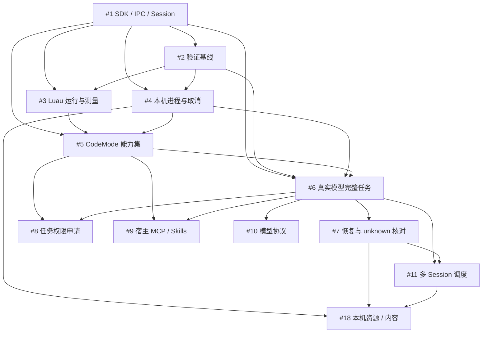

# CAYW 开发路线图

[项目说明](../README.md) · [架构设计](architecture.md) · [验收与关闭规则](#严格验收与完成条件) · [GitHub Issues](https://github.com/changw98ic/CAYW/issues)

## 当前主线

2026-10-19 起，交付范围收敛为 **macOS 本机无界面 Agent 运行时**，通过公开 Rust SDK 和认证本机 IPC 使用。主线包括模型循环、Luau 工具编排、持久会话、权限与预算、取消与恢复、本机进程管理、多会话调度、宿主 MCP/Skills 接入，以及本机资源和内容管理。

- [#1](https://github.com/changw98ic/CAYW/issues/1) 已完成 macOS ARM64、固定离线模型范围的验收并关闭；它不证明当前持久化 Runtime 的真实模型全链通过。
- 待完成主线为 **#2–#11 和 #18，共 11 项**。已有代码和局部验证继续复用，状态统一记为“待完成验收”，不因本次范围调整标为完成。
- **不做 plugin、TUI、WebUI、远程服务或跨设备同步。** #12–#17 按“不再计划”关闭，不计为已交付；既有源码和历史证据不因计划取消而删除，也不成为主线依赖。
- Linux/Windows 由 [#19](https://github.com/changw98ic/CAYW/issues/19) 保留为后续非主线任务，现在不实施、不验证、不阻塞 macOS。
- 使用模型服务和宿主已有 MCP/Skills 不等于建设远程 Device/Server 产品；本机 IPC 仍需认证、版本校验和明确的监听边界。

GitHub 当前真实任务编号为 #1–#19。旧路线图误列的“#22 上下文压缩”和“#23 API 补齐”已移除：#22 是文档 PR，#23 当前不存在。本次不据此新增任务或隐含扩大主线。

## 交付顺序

先完整交付并验收一个 Issue，再推进依赖它的任务。实现、定向验证、独立复核与主线接入都完成，才可关闭；不能用多个零散实现或测试数量代替结项。

### A：执行与验证底座（#1–#5）

#1 是已有起点。当前先完成 #2 的 VerifyTool、证据格式和基础故障场景；#3 的 Luau 测量与 #4 的 macOS 进程治理在 #2 后可并行，随后汇入 #5 的预置能力集。

#2 不等待 #6 或之后所有任务的真实验收：它先交付可运行工具、固定离线样本、负向对照和报告规则。真实任务数据缺失时明确待测；正式模型任务对比在 #6 后另获授权运行。#3 同样不以 #6 为前置，Monty 对照不是主线门槛。

#5 保留原有工具能力清单，不因去掉 UI 而删除程序可消费的文字、图片、音频、通知、审批或澄清数据。所有原语和能力须有逐项矩阵与行为测试；不能用文件读写示例代表全部完成。#5 只验宿主桥接和子代理调用的基础契约，MCP/Skills 实际来源接入归 #9，不制造 #5 与 #9 的依赖环。

### B：首个无界面真实模型完整任务（#6）

底座验收完成后，由独立 Rust 客户端通过 SDK 和本机 IPC 使用同一 Runtime，跑通流式多轮模型 → Luau → Host 工具 → 结果 → 后续回答，并验证审批、取消、游标续读和同一 Session 重开。普通运行不依赖 VerifyTool、UI、plugin 或远程服务。

#6 包含最小恢复和未知副作用处理；#7 深化故障覆盖，不能将基本安全语义推迟到 #7。真实模型证据需在对应调用授权与预算内获得；本次文档和 Issue 更新不启动调用。

### C：恢复、权限、宿主接入、模型与并发（#7–#11）

#7–#10 在 #6 后按各自依赖推进；#11 还依赖 #7。并行工作按文件和公共契约协调，多个作者不替代最终组合验收。

- #7：按真实副作用和持久化边界故障，证明不重复执行、不接受旧执行者结果；核对前保留 unknown，清理未确认保留执行名额。
- #8：可信宿主评估和授予精确任务权限；申请次数和模型声称获批都不能自动放行。审批和澄清通过 API/事件消费，不需要建设界面。
- #9：宿主持有单一 MCP 连接和 Skills 加载入口；Core 消费注入能力，来源更换、撤销和迟到结果必须核对。
- #10：清单固定为 OpenAI Chat Completions、Anthropic Messages、Gemini generateContent/streamGenerateContent 和 Magpie Chat Completions 兼容 API，四项分别取得固定数据、本地 HTTP 和授权真实服务证据。每次运行固定具体模型和 API 版本，不以“兼容”扩展到所有厂商或模型；详细条件见 [#10](https://github.com/changw98ic/CAYW/issues/10)。
- #11：持久队列、容量、优先级和防长期等待策略；验收前固定可判定的有限派发机会规则，使用受控执行和事件顺序验证，不写固定毫秒通过阈值。

### D：本机资源与内容（#18）

#18 在 #4、#7、#11 后交付本机资源准入/预算/清理、本地权威内容、读写校验、冲突处理与重开恢复。**不含 Server、远程绑定、跨设备备份或加密同步，无 #15 条件依赖。**

资源矩阵必须分别说明 CPU、内存、GPU 和 I/O 的可观测、可控制、明确不支持与未验证状态；不以统计值冒充硬限制。至少有真实可执行的本机资源策略和内容路径，不能只靠矩阵文档结项。未实现的硬件能力明确拒绝，不要求 macOS 提供不存在的 GPU 强制隔离能力。

## 主线依赖表

硬依赖表示交付和验收前置；可以先准备样例与评审，不以此宣称跨过依赖。下表与依赖图须同步维护。

| Issue | 交付目标 | 硬依赖 | 状态与范围 |
| --- | --- | --- | --- |
| [#1](https://github.com/changw98ic/CAYW/issues/1) | Session/事件契约、公开 SDK 与本机 IPC | 无 | 已完成；[历史验收范围](validation/issue1-sdk-ipc.md)不外推 |
| [#2](https://github.com/changw98ic/CAYW/issues/2) | VerifyTool、故障注入与可复跑证据基线 | #1 | 待完成验收；不等待 #6 的真实数据 |
| [#3](https://github.com/changw98ic/CAYW/issues/3) | Luau 同机运行与测量 | #1、#2 | 待完成验收；Monty 不作门槛 |
| [#4](https://github.com/changw98ic/CAYW/issues/4) | macOS 进程归属、统一取消与预算 | #1、#2 | 待完成验收；不含其他平台 |
| [#5](https://github.com/changw98ic/CAYW/issues/5) | 预置 CodeMode 能力集与受控 Rust 执行 | #1、#3、#4 | 待完成验收；逐项能力矩阵 |
| [#6](https://github.com/changw98ic/CAYW/issues/6) | 独立客户端的真实模型多轮工具任务 | #1、#2、#4、#5 | 待完成验收；需要授权真实证据 |
| [#7](https://github.com/changw98ic/CAYW/issues/7) | 故障恢复、unknown 核对与旧执行者隔离 | #6 | 待完成验收 |
| [#8](https://github.com/changw98ic/CAYW/issues/8) | 按任务申请、可信评估、授予和撤销 | #5、#6 | 待完成验收 |
| [#9](https://github.com/changw98ic/CAYW/issues/9) | 宿主 MCP/Skills 单一来源接入 | #5、#6 | 待完成验收；不依赖 plugin |
| [#10](https://github.com/changw98ic/CAYW/issues/10) | 有限清单的模型协议适配与证据 | #6 | 待完成验收；未验证协议不标支持 |
| [#11](https://github.com/changw98ic/CAYW/issues/11) | 本机多 Session 队列、并发与恢复公平性 | #6、#7 | 待完成验收 |
| [#18](https://github.com/changw98ic/CAYW/issues/18) | 本机资源策略与权威内容存放/恢复 | #4、#7、#11 | 待完成验收；不含跨设备同步 |

## 已退出主线的任务

| Issue | 决定 | 与主线关系 |
| --- | --- | --- |
| [#12](https://github.com/changw98ic/CAYW/issues/12) | plugin 接口与生命周期不再计划 | 不作为主线前置，不记为交付完成 |
| [#13](https://github.com/changw98ic/CAYW/issues/13) | TUI 不再计划 | SDK/IPC 由独立程序和 VerifyTool 验收 |
| [#14](https://github.com/changw98ic/CAYW/issues/14) | WebUI/轻网关不再计划 | 不要求浏览器或本地网页服务 |
| [#15](https://github.com/changw98ic/CAYW/issues/15) | 远程服务不再计划 | 不要求两机、远程绑定或部署 TLS |
| [#16](https://github.com/changw98ic/CAYW/issues/16) | StrongFlow plugin 不再计划 | 不引入强流程绑定作为普通主链要求 |
| [#17](https://github.com/changw98ic/CAYW/issues/17) | JEv/Fusion/Observer plugin 不再计划 | 不引入插件诊断/协作验收门槛 |
| [#19](https://github.com/changw98ic/CAYW/issues/19) | Linux/Windows 保留后续计划，尚不实施 | 仅以后复用主线契约；当前主线不依赖它 |

原任务正文保留为历史，不能依据已取消内容恢复排期。未来重新纳入须有明确范围决定，不能因源码中已有包或 feature 自动恢复。

## 严格验收与完成条件

严格验收条件直接写在各主线 Issue 的“严格验收”和“证据与关闭门槛”中，入口见上方主线依赖表；本节汇总共同规则。本次完成的是范围与验收规则检查，产品仍需按对应源码实际运行验收。

- 运行证据绑定实际源码/构建、Cargo.lock、feature、macOS 版本/架构、配置、权限、输入、命令、退出码、原始日志和结果。版本或组合变化后重跑受影响场景。
- 使用公开 SDK/认证 IPC 和实际 Runtime/SQLite/Host/Device 路径；本地 HTTP/固定模型明确标记，不能冒充真实 Provider。
- 正向结果、拒绝/越权、取消、崩溃/迟到结果及资源回收分别断言。预期故障只有在错误与副作用状态都符合预期时才算该场景通过，不把业务失败改成成功任务。
- unknown 不归零、不重放；进程或持久化清理未确认不释放名额。最终回答或退出码不能替代执行结果、输出分页和原调用配对核对。
- 真模型测试另需明确调用授权；缺必需真实证据的 #6/#10 不能关闭。#2/#3 的可选真实比较缺失不阻塞其离线交付，不形成循环依赖。
- 记录冷暖、首执行、编排、取消和资源原始样本；比较条件不一致时拒绝比较，缺失数据保持待测，故障与修复成本不丢失。不使用固定毫秒阈值或臆测性能收益。
- 独立复核须核对确切交付源码并运行关键反例，不以作者报告代替。状态只在交付与证据完成后更新，不以取消、缩范围或文档修改冒充完成。

## 更新方式

GitHub Issue 是对应任务范围与验收的权威入口；本路线图维护主线、依赖、顺序和证据链接。改动范围时同步对应 Issue、路线图表格、依赖图和验收摘要。本次修改仅限 Issues 和本路线图；历史验收文件保持原始范围，不追改成新版本通过记录，不删除源码或修改依赖、许可证、CI、部署及外部自动化。
