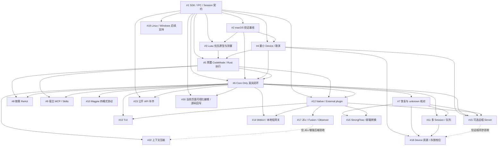

# CAYW 开发路线图

本路线图在原 21 个交付型 Issues（原 18 项、后续平台支持 #19、上下文压缩 [#22](https://github.com/changw98ic/CAYW/issues/22) 和公开 API 补齐 [#23](https://github.com/changw98ic/CAYW/issues/23)）之外，加入 2026-10-23 的当前页面可视化编辑 [#30](https://github.com/changw98ic/CAYW/issues/30)。#30 独立跟踪，不恢复已退出原主线的 #14 完整历史范围。2026-10-19 起统一用词：测试工具称 VerifyTool（代码包 `cayw-verify-tool`），StrongFlow/JEv/Fusion/Observer 及第三方扩展统一称 plugin，分 Native plugin 与 External plugin（代码包 `cayw-plugins`）。**当前首发只面向 macOS；2026-10-19 用户明确取消本阶段 Windows、Linux 的适配与验收要求。** #1 已完成 macOS ARM64 首发范围的本地功能验收并关闭；实现、独立客户端和验收说明已由 PR #20 合并到 `main`。Linux 与 Windows 的后续支持已独立建立 [#19](https://github.com/changw98ic/CAYW/issues/19)，不阻塞 macOS 首发，也不表示现在恢复平台工作。其他任务继续按依赖推进；#2、#4、#13 正文中原有的三平台要求已于 2026-10-19 收窄为 macOS，Linux/Windows 部分指向 #19。2026-10-18 起先独立实现 Rust 消息、模型流与工具循环，随后已加入持久化 Core、Runtime/版本化 IPC、Luau/Cells、Host、Device 和其他可选组件；当前 workspace 成员以根 `Cargo.toml` 为准。早期 macOS / Linux 离线结果及 macOS 的有限 Magpie + DS Flash 检查，只覆盖当时的内核（见 [内核边界](rust-pi-core.md)、[离线验收](validation/rust-pi-core.md) 和 [真实模型记录](validation/rust-pi-core-magpie.md)）。后续 [Core 修复验收](validation/core-boundary-repairs.md)、[Runtime 宿主接入](validation/runtime-bridge.md)、[SDK / IPC 早期离线验证](validation/sdk-ipc-harness.md)、[Issue #1 客户端与取消修复验收](validation/issue1-sdk-ipc.md)、[Workspace 读取接口](../crates/cayw-workspace/README.md)、[diff 文件结束标记修复](validation/workspace-diff-eof.md)、[共享读取接线复核](validation/shared-read-runtime.md)、[Device 交互进程验证](validation/device-interactive-process.md) 与 [网页本地运行验证](validation/webui-runtime.md) 有单独范围；当前源码也已包含 SDK、持久化、Luau 和权限链实现，不能继续写成全部未实现。其余 Issue 的 macOS 验证、真实模型与持久化 Runtime 全链等仍需补齐，不能据局部通过认定全部任务完成。每项任务的功能范围和验收仍以对应 Issue 为准；平台范围采用上述用户最新决定，不再沿用原三平台首发要求。

[返回项目说明](../README.md) · [架构文档](architecture.md) · [查看全部 Issues](https://github.com/changw98ic/CAYW/issues)

## 从哪里开始

**先把 Rust Agent 内核做出来，再在其上夯实 Stage A 执行底座。** `cayw-ai` / `cayw-agent` 的早期离线、本地 HTTP 和有限 Magpie + DS Flash 记录已保存。随后 Runtime 已接入持久化、Luau、工具权限、队列和恢复；共享读取与 Device 交互进程已分别验证。这些早期记录不包含随后 #2、#3、#4 的验收。2026-10-21 的 [交付检查](validation/issue-234-macos-delivery.md)分别列出验证基线、Luau 测量、进程清理与有限真实模型补充；长会话绑定读取及工具数字参数修复随本次交付进入 Runtime。这些有限场景不代替 [#6](https://github.com/changw98ic/CAYW/issues/6) 的完整验收；#6 随后已完成独立授权的 macOS ARM64 本地验收，详见[真实闭环记录](validation/issue-6-headless-chat-macos.md)。

[#1](https://github.com/changw98ic/CAYW/issues/1) 的独立 Rust SDK/版本化 IPC 客户端、Session/事件契约和跨实例取消修复已接主树；事件订阅和续订、审批与取消、工具结果配对、同一会话重开恢复通过 macOS ARM64 离线复核。完整默认 workspace 测试通过 1,185 项，另有 5 个默认忽略入口；严格检查和所有目标/feature 编译通过，具体范围见[验收记录](validation/issue1-sdk-ipc.md)。按当前 macOS 首发范围，#1 的本地功能验收完成；不再等待 Windows/Linux。[#2](https://github.com/changw98ic/CAYW/issues/2) 的 macOS 可重复验证基线已由 PR #27 合并到 `dev` 并关闭。基于 Luau 的语言原型 [#3](https://github.com/changw98ic/CAYW/issues/3) 与最小 Device [#4](https://github.com/changw98ic/CAYW/issues/4) 已完成各自声明的 macOS ARM64 验收，交付与复跑入口见 [本次记录](validation/issue-234-macos-delivery.md)。[#5](https://github.com/changw98ic/CAYW/issues/5) 的八组预置 CodeMode 能力已完成 macOS ARM64 本地交付与验收，见[逐能力矩阵](issue5-capabilities.md)和[验收记录](validation/issue-5-preset-capabilities-macos.md)；代码随本次 `dev` 提交交付，GitHub Issue 状态未同步。[#6](https://github.com/changw98ic/CAYW/issues/6) 已交付可安装 Runtime、独立 SDK/IPC 客户端与可信配置。固定响应回归与授权真实运行分开记录；SDK/IPC 已各完成两个真实用户回合，取消补跑、原件只读核证、独立控制复核及 11 项交付条件的收据检查均完成，macOS ARM64 整项本地验收通过。累计 106 次真实 HTTP 响应，已报告 231,417 token，未知用量保留 5,500,000 token，未结算为 0；独立授权为 500M。代码随本次 `dev` 提交交付，GitHub Issue 状态未同步。见[使用入口](headless-chat.md)和[本地验证记录](validation/issue-6-headless-chat-macos.md)。原有 Issues 的硬依赖不变。

阶段是阅读导航。每个任务只需满足自己的硬依赖即可启动，不需要等上一阶段所有分支结束。并行任务若触及相同文件或契约，应先协调接口变更。没有预设负责人、截止日期、性能结论或模型质量评分。

## 分阶段交付

### A：最小接口、验证底座与统一执行

- [#1](https://github.com/changw98ic/CAYW/issues/1)：先交付可执行的公开 Rust SDK 和版本化 IPC 往返，不先冻结完整接口或铺设空架构。
- [#2](https://github.com/changw98ic/CAYW/issues/2)：macOS 验证基线已合并并关闭。VerifyTool 只用于验证，不是 Core 运行依赖；离线比较和反例已运行，缺少关键构建资料时保持 pending。后续任务继续补充自己的场景，正式真实任务性能比较在 #6 后经授权运行。
- [#3](https://github.com/changw98ic/CAYW/issues/3)：[Luau 原型与同机测量](validation/issue-3-luau-macos.md)已验收，包含十八个正式场景、每场景三次采样及独立反例。Monty 是可选对照，不阻塞本项。
- [#4](https://github.com/changw98ic/CAYW/issues/4)：[macOS 进程身份、Pipes/PTY、取消和清理](validation/issue-4-macos-process-lifecycle.md)已按具名拓扑验收。原进程身份、清理失败和业务效果不明分别保留。
- [#5](https://github.com/changw98ic/CAYW/issues/5)：[八组预置 CodeMode 能力及受控 Rust 分派](validation/issue-5-preset-capabilities-macos.md)已完成 macOS ARM64 本地验收；单元、共享读取、文件、检索、数据、Git、进程和宿主协作均有具名证据。所有执行路径共用权限、调用配对、取消和预算。代码随本次 `dev` 提交交付，未修改远端 Issue 状态。

### B：首个 Core Only 真实闭环

[#6](https://github.com/changw98ic/CAYW/issues/6) 在 Stage A 执行底座与预置 CodeMode 稳固后推进（非首阶段第一要务）：不安装或启动 UI、Server、VerifyTool 或任何 plugin，通过 API 完成流式多轮 Chat、真实工具执行、取消和持久化恢复。模型协议先选一个完成真实闭环，再逐步扩展。

事件游标、审批、取消、工具 call/result 配对、Session/Worker 解耦、最小持久化与副作用 unknown 核对必须在此切片中存在。[#7](https://github.com/changw98ic/CAYW/issues/7) 负责扩展故障覆盖，不能把这些基本语义推迟到后续。审批先做可用最小路径，不以复杂框架阻塞主链。

### C：恢复、能力接入、协议与并发

[#7](https://github.com/changw98ic/CAYW/issues/7)、[#8](https://github.com/changw98ic/CAYW/issues/8)、[#9](https://github.com/changw98ic/CAYW/issues/9)、[#10](https://github.com/changw98ic/CAYW/issues/10) 在各自依赖满足后可并行；[#11](https://github.com/changw98ic/CAYW/issues/11) 在恢复边界明确后完善队列、公平性与多 Session 资源归属。

- Session 是持久逻辑，Worker 是可更换执行者。恢复先核对 unknown 副作用，不能盲重放；取消、审批与结果终态要有执行围栏。
- [#10](https://github.com/changw98ic/CAYW/issues/10) 按 2026-10-23 用户决定验收本机 Magpie 四格式：Chat Completions、Responses、Anthropic Messages 和 Gemini 流式调用，固定模型及实际 SDK/认证 IPC 路径见[服务与证据矩阵](validation/issue-10-provider-protocols-macos.md)。官方服务直连和旧 group 路由保留未验证，移出本项关闭范围。新增服务只加适配器、不改 Core；支持声明限于实际模型、配置、源码和场景。
- [#11](https://github.com/changw98ic/CAYW/issues/11) 的队列支持任务优先级，低优先级任务等待过久会逐步提升，不会被饿死。
- [#22](https://github.com/changw98ic/CAYW/issues/22) 在 #6 之后交付 Core 基础上下文压缩：不拆开调用与结果，不改写原始执行记录和 unknown 状态；JEv plugin 可提供增强压缩，失败时回退到 Core 基础压缩。
- [#23](https://github.com/changw98ic/CAYW/issues/23) 在 #1 已有接口上补齐 Session 分叉、模型配置、工具注册与授权、上下文读取与受控修改、资源查询与预算申请；只提供 Rust SDK 与 IPC，不做 TypeScript/Python SDK。
- 宿主统一接入 MCP 与 Skills，CodeMode 按需发现/读取/调用。Core 不重复创建 loader 或 MCP 连接；CodeGraph、跨文件语义分析和外部 search 由宿主提供。Workspace 的有界文本检索和 Rust 单文件语法大纲不替代这些能力。
- 默认不暴露 Bash/Shell/Node/Python 或任意进程旁路。常规开发与受控构建/测试需求优先由 [#5](https://github.com/changw98ic/CAYW/issues/5) 已经做好的 CodeMode 能力集覆盖；出现真实能力缺口时，模型按用途申请，持续有效申请触发评估，次数不能自动授权。两次阈值只是建议参数，明确项目测试/脚本需求可首轮开放。能力限定于任务，底层权限不扩大，取消和预算保持统一。

### D：plugin 接口、界面与远程

[#12](https://github.com/changw98ic/CAYW/issues/12) 在真实 SDK/IPC 上交付 plugin 接口与完整生命周期（发现、校验、授权、初始化、启用、停止/升级/卸载）、plugin 模板和 plugin 自检；其后的 [#13](https://github.com/changw98ic/CAYW/issues/13)、[#14](https://github.com/changw98ic/CAYW/issues/14)、[#15](https://github.com/changw98ic/CAYW/issues/15)、[#16](https://github.com/changw98ic/CAYW/issues/16)、[#17](https://github.com/changw98ic/CAYW/issues/17) 可并行推进，不把全部 Provider 或所有 UI 变成 Core 前置条件。

- 可信 Native plugin 通过 Cargo feature 静态链接，升级需重新编译。External plugin 通过独立进程 IPC 接入，管理权限与生命周期；进程隔离不等同安全沙箱。plugin 不能直接读写 Core 数据库，不能绕过审批。
- 公开接口先有最小真实往返，再由 [#2](https://github.com/changw98ic/CAYW/issues/2) 的 VerifyTool 与 [#13](https://github.com/changw98ic/CAYW/issues/13) 的真实消费共同验证。[#12](https://github.com/changw98ic/CAYW/issues/12) 完成初版不代表 SDK 已稳定；稳定版本需相应消费与兼容性证据。
- TUI 与 WebUI 可拆。TUI 增加只读的文件、Diff 和日志查看；WebUI 增加多项目管理和 plugin 管理页面，多设备管理暂不做。WebUI 的本地轻网关消费公开接口，不依赖可选远程 Server。
- 可选 Server 管远程绑定、认证吊销、路由与重连；Device 仅出站连接，无需入站端口。监听地址、公开 URL、TLS/代理、绑定成功响应丢失、断线与吊销恢复必须明确，并提供独立两机证据。
- StrongFlow/JEv/Fusion/Observer 都可插拔，普通 Chat 不依赖它们。已有 StrongFlow 任务在该 plugin 卸载后仍不能静默绕过已绑定流程：原 Session 直接提示不可用并保持原绑定冻结，同时提供显式 Fork 转换选项（由用户确认后分叉为新的普通 Session 并记录来源关系）；Observer 诊断失败、缓慢或队列饱和不阻塞主链。

### 当前页面的可视化编辑

[#30](https://github.com/changw98ic/CAYW/issues/30) 依赖 #1 的公开接口与 #6 的执行底座，作为独立可选应用交付。核心路径是当前项目页面进入编辑、拖拽与右键修改、插入组件、保存回源码及重启后继续编辑。HTML/CSS 已完成 macOS ARM64 本地验收；Vite React JSX/TSX 与 Vue 3 已适配，并通过合成项目的多文件保存、停服重启和外部修改冲突流程。当前范围见[可视化编辑说明](visual-editor.md)，最新结果见[精简重测记录](validation/issue-30-editor-simplification-macos.md)；适配阶段见[框架验收记录](validation/issue-30-framework-editor-macos.md)，较早的 HTML 结果见[历史记录](validation/issue-30-visual-editor-macos.md)。当次 Magpie 100M token 验收已获授权，但环境缺少凭据，真实生成请求为 0，生成项目后的完整验收仍待完成。代码位于独立分支 `issue/30-visual-editor`，GitHub Issue 状态未同步；不把本地合成结果写成整项结项。该任务不要求先恢复 #12/#14 的历史范围。

### E：Device 资源与内容部署深化

[#18](https://github.com/changw98ic/CAYW/issues/18) 在最小进程治理、恢复和并发之后推进 CPU/内存/GPU 策略、权威存放档位与可选加密同步。Device 持有权威内容。磁盘与网络 I/O 只做监控和并发数限制（软限制，超过时排队）。复杂治理和全部档位不在首个切片堆叠实现。

本地资源与存放档位不依赖远程 Server；仅远程同步验收有 [#15](https://github.com/changw98ic/CAYW/issues/15) 这一条件依赖。尚未实现/验证的档位和硬件支持必须保持计划或未验证状态。

### 后续平台：Linux 与 Windows

[#19](https://github.com/changw98ic/CAYW/issues/19) 独立跟踪 Linux 与 Windows 的产品适配和原生验收，硬依赖为 #1 的公开 SDK、IPC 与 Session 契约；验证格式、进程治理、恢复和资源策略分别关联 #2/#4/#7/#18。该任务不属于当前 macOS 首发范围，也不成为其他任务的 macOS 前置条件。既有平台研究保持历史与未验证状态，创建 Issue 不表示恢复适配或环境排查。

## Issues、硬依赖与并行关系

硬依赖表示实现/验收所需的前置交付，不表示必须先完成所有同阶段任务。并行列中的任务也需满足各自硬依赖；双向并行关系不是依赖边。

| Issue / 交付目标 | 阶段 | 硬依赖 | 可并行任务 / 条件依赖 | 状态 |
| --- | --- | --- | --- | --- |
| [[Core] 交付 Session/事件契约、最小 Rust SDK 与版本化 IPC 实接](https://github.com/changw98ic/CAYW/issues/1) | A | 无 | — | [已完成 macOS ARM64 首发范围的本地验收](validation/issue1-sdk-ipc.md)；GitHub 已关闭；实现与客户端已由 PR #20 合并到 `main` |
| [[验证] 建立 macOS、故障注入与任务性能比较的可重复基线](https://github.com/changw98ic/CAYW/issues/2) | A | [#1](https://github.com/changw98ic/CAYW/issues/1) | — | 已完成 macOS ARM64 范围验收；PR #27 已合并到 `dev`，GitHub 已关闭；[交付记录](validation/issue-234-macos-delivery.md) |
| [[CodeMode] 优先基于 Luau 交付同机原型与测量报告（Monty 可选对照）](https://github.com/changw98ic/CAYW/issues/3) | A | [#1](https://github.com/changw98ic/CAYW/issues/1)、[#2](https://github.com/changw98ic/CAYW/issues/2) | [#4](https://github.com/changw98ic/CAYW/issues/4) | [已完成 macOS ARM64 范围验收](validation/issue-3-luau-macos.md)；GitHub 状态以 Issue 为准 |
| [[Device] 交付最小进程树归属、统一取消与执行预算](https://github.com/changw98ic/CAYW/issues/4) | A | [#1](https://github.com/changw98ic/CAYW/issues/1)、[#2](https://github.com/changw98ic/CAYW/issues/2) | [#3](https://github.com/changw98ic/CAYW/issues/3) | [已完成具名 macOS ARM64 场景验收](validation/issue-4-macos-process-lifecycle.md)；GitHub 状态以 Issue 为准 |
| [[CodeMode] 交付预置 CodeMode 能力集与受控 Rust 执行链](https://github.com/changw98ic/CAYW/issues/5) | A | [#1](https://github.com/changw98ic/CAYW/issues/1)、[#3](https://github.com/changw98ic/CAYW/issues/3)、[#4](https://github.com/changw98ic/CAYW/issues/4) | — | [已完成 macOS ARM64 本地验收](validation/issue-5-preset-capabilities-macos.md)；代码随本次 `dev` 提交交付，GitHub Issue 状态未同步 |
| [[Core] 交付首个协议的 Headless 流式多轮 Chat 与工具真实闭环](https://github.com/changw98ic/CAYW/issues/6) | B | [#1](https://github.com/changw98ic/CAYW/issues/1)、[#2](https://github.com/changw98ic/CAYW/issues/2)、[#4](https://github.com/changw98ic/CAYW/issues/4)、[#5](https://github.com/changw98ic/CAYW/issues/5) | — | [已完成 macOS ARM64 整项本地验收](validation/issue-6-headless-chat-macos.md)，包含完整回归、SDK/IPC 各两个真实用户回合、取消补跑及独立复核；代码随本次 `dev` 提交交付，GitHub Issue 状态未同步 |
| [[Session] 完善持久化恢复、副作用 unknown 核对与执行围栏](https://github.com/changw98ic/CAYW/issues/7) | C | [#6](https://github.com/changw98ic/CAYW/issues/6) | [#8](https://github.com/changw98ic/CAYW/issues/8)、[#9](https://github.com/changw98ic/CAYW/issues/9)、[#10](https://github.com/changw98ic/CAYW/issues/10) | [已完成 macOS ARM64 整项本地验收](validation/issue-7-crash-recovery-macos.md)：40 个实际 SIGKILL 窗口、六个可信核对场景、独立组合故障复现及最终完整检查；代码随本次 `dev` 提交交付，GitHub Issue 状态未同步 |
| [[权限] 交付按需 ReAct 能力申请和任务限定开放](https://github.com/changw98ic/CAYW/issues/8) | C | [#5](https://github.com/changw98ic/CAYW/issues/5)、[#6](https://github.com/changw98ic/CAYW/issues/6) | [#7](https://github.com/changw98ic/CAYW/issues/7)、[#9](https://github.com/changw98ic/CAYW/issues/9)、[#10](https://github.com/changw98ic/CAYW/issues/10) | [已完成 macOS ARM64 整项本地验收](validation/issue-8-task-capabilities-macos.md)：可信 SDK/认证 IPC 裁决、实际项目测试、跨任务和撤销反例、独立八条件复核；代码随本次 `dev` 提交交付，GitHub Issue 状态未同步 |
| [[宿主] 交付统一 MCP/Skills 接入与 CodeMode 按需发现](https://github.com/changw98ic/CAYW/issues/9) | C | [#5](https://github.com/changw98ic/CAYW/issues/5)、[#6](https://github.com/changw98ic/CAYW/issues/6) | [#7](https://github.com/changw98ic/CAYW/issues/7)、[#8](https://github.com/changw98ic/CAYW/issues/8)、[#10](https://github.com/changw98ic/CAYW/issues/10) | [已完成 macOS ARM64 整项本地验收](validation/issue-9-host-sources-macos.md)：实际 stdio MCP、Markdown Skill、宿主检索、SDK/认证 IPC、来源生命周期与七条件复核；固定 Provider，无真实模型调用；代码随本次 `dev` 提交交付，GitHub Issue 状态未同步 |
| [[Provider] 交付 Magpie 四格式的有限模型协议适配](https://github.com/changw98ic/CAYW/issues/10) | C | [#6](https://github.com/changw98ic/CAYW/issues/6) | [#7](https://github.com/changw98ic/CAYW/issues/7)、[#8](https://github.com/changw98ic/CAYW/issues/8)、[#9](https://github.com/changw98ic/CAYW/issues/9) | [已完成批准的 Magpie 四格式 macOS ARM64 整项本地验收](validation/issue-10-provider-protocols-macos.md)：逐行真实两用户回合、r03 完整本地检查、源码影响及十条件复核；原失败和未知预留保留；范围已同步 GitHub，Issue 仍 OPEN；代码随本次 `dev` 提交交付 |
| [[调度] 交付多 Session 并发、队列和恢复公平性](https://github.com/changw98ic/CAYW/issues/11) | C | [#6](https://github.com/changw98ic/CAYW/issues/6)、[#7](https://github.com/changw98ic/CAYW/issues/7) | [#9](https://github.com/changw98ic/CAYW/issues/9)、[#10](https://github.com/changw98ic/CAYW/issues/10)、[#8](https://github.com/changw98ic/CAYW/issues/8) | 计划 |
| [[plugin] 交付 Native / External plugin 接口与完整生命周期](https://github.com/changw98ic/CAYW/issues/12) | D | [#1](https://github.com/changw98ic/CAYW/issues/1)、[#5](https://github.com/changw98ic/CAYW/issues/5)、[#6](https://github.com/changw98ic/CAYW/issues/6) | [#11](https://github.com/changw98ic/CAYW/issues/11)、[#10](https://github.com/changw98ic/CAYW/issues/10)、[#7](https://github.com/changw98ic/CAYW/issues/7) | 计划 |
| [[TUI] 交付独立可选 TUI 并验证公开 SDK/IPC](https://github.com/changw98ic/CAYW/issues/13) | D | [#6](https://github.com/changw98ic/CAYW/issues/6)、[#12](https://github.com/changw98ic/CAYW/issues/12) | [#14](https://github.com/changw98ic/CAYW/issues/14)、[#15](https://github.com/changw98ic/CAYW/issues/15)、[#16](https://github.com/changw98ic/CAYW/issues/16)、[#17](https://github.com/changw98ic/CAYW/issues/17) | 计划 |
| [[WebUI] 交付独立 WebUI 与不依赖 Server 的本地轻网关](https://github.com/changw98ic/CAYW/issues/14) | D | [#6](https://github.com/changw98ic/CAYW/issues/6)、[#12](https://github.com/changw98ic/CAYW/issues/12) | [#13](https://github.com/changw98ic/CAYW/issues/13)、[#15](https://github.com/changw98ic/CAYW/issues/15)、[#16](https://github.com/changw98ic/CAYW/issues/16)、[#17](https://github.com/changw98ic/CAYW/issues/17) | 计划 |
| [[Server] 交付出站 Device 远程绑定、认证吊销、路由重连与两机验收](https://github.com/changw98ic/CAYW/issues/15) | D | [#4](https://github.com/changw98ic/CAYW/issues/4)、[#6](https://github.com/changw98ic/CAYW/issues/6)、[#7](https://github.com/changw98ic/CAYW/issues/7)、[#12](https://github.com/changw98ic/CAYW/issues/12) | [#13](https://github.com/changw98ic/CAYW/issues/13)、[#14](https://github.com/changw98ic/CAYW/issues/14)、[#16](https://github.com/changw98ic/CAYW/issues/16)、[#17](https://github.com/changw98ic/CAYW/issues/17) | 计划 |
| [[StrongFlow] 交付可插拔强流程、卸载不可用提示与 Fork 转换选项](https://github.com/changw98ic/CAYW/issues/16) | D | [#7](https://github.com/changw98ic/CAYW/issues/7)、[#12](https://github.com/changw98ic/CAYW/issues/12) | [#13](https://github.com/changw98ic/CAYW/issues/13)、[#14](https://github.com/changw98ic/CAYW/issues/14)、[#15](https://github.com/changw98ic/CAYW/issues/15)、[#17](https://github.com/changw98ic/CAYW/issues/17) | 计划 |
| [[扩展] 交付 JEv/Fusion/Observer 的可插拔最小适配与非阻塞诊断](https://github.com/changw98ic/CAYW/issues/17) | D | [#12](https://github.com/changw98ic/CAYW/issues/12) | [#13](https://github.com/changw98ic/CAYW/issues/13)、[#14](https://github.com/changw98ic/CAYW/issues/14)、[#15](https://github.com/changw98ic/CAYW/issues/15)、[#16](https://github.com/changw98ic/CAYW/issues/16) | 计划 |
| [[Device] 交付资源策略、权威存放档位与可选加密同步](https://github.com/changw98ic/CAYW/issues/18) | E | [#4](https://github.com/changw98ic/CAYW/issues/4)、[#7](https://github.com/changw98ic/CAYW/issues/7)、[#11](https://github.com/changw98ic/CAYW/issues/11) | —；远程同步验收另需 [#15](https://github.com/changw98ic/CAYW/issues/15) | 计划 |
| [[Core] 交付上下文压缩：Core 基础压缩与 plugin 增强回退](https://github.com/changw98ic/CAYW/issues/22) | C | [#6](https://github.com/changw98ic/CAYW/issues/6) | [#7](https://github.com/changw98ic/CAYW/issues/7)、[#10](https://github.com/changw98ic/CAYW/issues/10)；JEv 增强压缩验收另需 [#17](https://github.com/changw98ic/CAYW/issues/17) | 计划 |
| [[API] 补齐公开 API：Session 分叉、模型配置、工具授权、上下文与预算](https://github.com/changw98ic/CAYW/issues/23) | C | [#1](https://github.com/changw98ic/CAYW/issues/1)、[#6](https://github.com/changw98ic/CAYW/issues/6) | [#10](https://github.com/changw98ic/CAYW/issues/10)、[#11](https://github.com/changw98ic/CAYW/issues/11)、[#12](https://github.com/changw98ic/CAYW/issues/12) | 计划 |
| [[页面编辑] 当前 UI 的可视化转换、拖拽、组件插入、右键修改与源码回写](https://github.com/changw98ic/CAYW/issues/30) | 独立应用 | [#1](https://github.com/changw98ic/CAYW/issues/1)、[#6](https://github.com/changw98ic/CAYW/issues/6) | 不恢复 #12/#14 的完整历史范围 | [HTML/CSS 已本地验收；React JSX/TSX、Vue 3 已适配并通过合成项目完整编辑流程](validation/issue-30-framework-editor-macos.md)；已授权 Magpie 100M，缺少凭据，真实请求 0，生成验收待完成；独立分支 `issue/30-visual-editor`，GitHub 状态未同步 |
| [[平台] 补齐 Linux 与 Windows 支持及原生验收](https://github.com/changw98ic/CAYW/issues/19) | 后续平台 | [#1](https://github.com/changw98ic/CAYW/issues/1) | 关联 #2/#4/#7/#18；不阻塞其 macOS 交付 | 计划；不属当前首发，尚未启动 |

## 依赖图

实线是硬依赖，虚线表示条件依赖：远程同步验收需要 #15，JEv 增强压缩验收需要 #17。具体验收与可并行关系见上表和各 Issue。

## 证据与完成标准

- 所有 Issue 以交付和可复跑验收结项，不以文档完成或模型自报代替功能实现。证据绑定源码/构建、配置、平台、输入、权限和实际结果。
- macOS、故障注入、多 Session、真实任务性能对比贯穿当前首发交付。Windows、Linux 不在本阶段范围，不继续适配或验证；macOS 内缺失的架构或场景仍标为未验证。不写固定毫秒级脆弱 CI 断言。
- fixture/synthetic 与真实 Provider/任务证据分开记录。真实闭环和模型成本测量须有明确授权；普通测试保持离线或本地 HTTP，不默认启动真实或付费模型。早期有限 Magpie 记录单独保存，不覆盖后续持久化 Runtime。缺失真实数据时保留验收缺口。
- 性能比较保留同机/环境、冷暖状态、首执行、真实编排、取消和修复成本等原始样本；不能只凭微基准承诺最快或性能收益。
- CAYW 的最终运行与依赖不包含 Codex；普通开源依赖允许。可复用经过分析的设计和适配经验，代码与许可证不自动继承。WinWinCode 停止开发，本路线图的新功能只进入 CAYW。
- 项目许可证为 Apache License 2.0；本计划不更改许可证、仓库权限、旧仓库状态、网站或外部自动化。未来如需执行这些操作，应取得对应任务授权。

## 更新方式

Issue 记录任务实施和验收事实；路线图维护依赖、阶段与入口。新增依赖先检查目标 Issue 真实存在并避免环路。取消或拆分任务时同步相关链接与依赖，不留悬空引用。状态只有在对应交付和验收证据完成后才能改为已完成。
