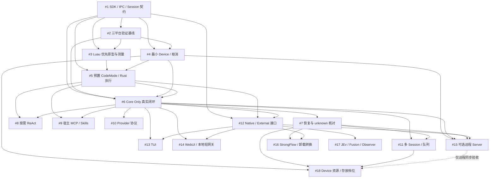

# CAYW 开发路线图

本路线图是开发计划，覆盖 18 个交付型 Issues；截至本次任务拆分，所有功能任务均未实现、未验收。每项任务的目标、范围/非范围、具体交付和可执行验收以对应 Issue 为准。本轮只创建 Issues 与规划文档，不实现代码、不启动模型测试，也不创建空 crate。

[返回项目说明](../README.md) · [查看全部 Issues](https://github.com/changw98ic/CAYW/issues)

## 从哪里开始

当前优先夯实 Stage A 执行底座（[#6](https://github.com/changw98ic/CAYW/issues/6) 不是第一要务）：先做 [#1](https://github.com/changw98ic/CAYW/issues/1) 的最小真实 Rust SDK/版本化 IPC 和 Session/事件契约，再建立 [#2](https://github.com/changw98ic/CAYW/issues/2) 的验证基线。优先基于 Luau 的语言原型 [#3](https://github.com/changw98ic/CAYW/issues/3) 与最小 Device [#4](https://github.com/changw98ic/CAYW/issues/4) 可以并行，随后汇入 [#5](https://github.com/changw98ic/CAYW/issues/5) 优先交付已经做好的 CodeMode 标准能力集与统一编排；待 Stage A 底座稳固后，再推进 [#6](https://github.com/changw98ic/CAYW/issues/6) 的首个流式对话闭环。

阶段是阅读导航。每个任务只需满足自己的硬依赖即可启动，不需要等上一阶段所有分支结束。并行任务若触及相同文件或契约，应先协调接口变更。没有预设负责人、截止日期、性能结论或模型质量评分。

## 分阶段交付

### A：最小接口、验证底座与统一执行

- [#1](https://github.com/changw98ic/CAYW/issues/1)：先交付可执行的公开 Rust SDK 和版本化 IPC 往返，不先冻结完整接口或铺设空架构。
- [#2](https://github.com/changw98ic/CAYW/issues/2)：三平台、故障注入与性能记录从这里开始，后续每个任务持续补充其场景；Harness 只用于验证，不是 Core 运行依赖。
- [#3](https://github.com/changw98ic/CAYW/issues/3) 与 [#4](https://github.com/changw98ic/CAYW/issues/4)：优先使用 Luau 实现同机语言原型（Monty 仅作可选对照，不阻塞主线），与最小进程树治理并行。冷/暖启动、首执行、真实编排、取消与离线样本验证都要有可核对记录。
- [#5](https://github.com/changw98ic/CAYW/issues/5)：优先提供已经做好的标准 CodeMode 能力集作为统一模型工具编排入口，底层由 Rust 能力执行；所有执行路径共用权限、调用配对、取消和预算。

### B：首个 Core Only 真实闭环

[#6](https://github.com/changw98ic/CAYW/issues/6) 在 Stage A 执行底座与预置 CodeMode 稳固后推进（非首阶段第一要务）：不安装或启动 UI、Server、Harness、可选工作流模块，通过 API 完成流式多轮 Chat、真实工具执行、取消和持久化恢复。模型协议先选一个完成真实闭环，再逐步扩展。

事件游标、审批、取消、工具 call/result 配对、Session/Worker 解耦、最小持久化与副作用 unknown 核对必须在此切片中存在。[#7](https://github.com/changw98ic/CAYW/issues/7) 负责扩展故障覆盖，不能把这些基本语义推迟到后续。审批先做可用最小路径，不以复杂框架阻塞主链。

### C：恢复、能力接入、协议与并发

[#7](https://github.com/changw98ic/CAYW/issues/7)、[#8](https://github.com/changw98ic/CAYW/issues/8)、[#9](https://github.com/changw98ic/CAYW/issues/9)、[#10](https://github.com/changw98ic/CAYW/issues/10) 在各自依赖满足后可并行；[#11](https://github.com/changw98ic/CAYW/issues/11) 在恢复边界明确后完善队列、公平性与多 Session 资源归属。

- Session 是持久逻辑，Worker 是可更换执行者。恢复先核对 unknown 副作用，不能盲重放；取消、审批与结果终态要有执行围栏。
- Provider 逐个推进 OpenAI、Anthropic、Gemini 与兼容实现，支持矩阵只列已验证协议能力，不猜模型能力评分。
- 宿主统一接入 MCP 与 Skills，CodeMode 按需发现/读取/调用。Core 不重复创建 loader 或 MCP 连接；CodeGraph/AST/search 留在外部宿主能力中。
- 默认不暴露 Bash/Shell/Node/Python 或任意进程旁路。常规开发与受控构建/测试需求优先由 [#5](https://github.com/changw98ic/CAYW/issues/5) 已经做好的 CodeMode 能力集覆盖；出现真实能力缺口时，模型按用途申请，持续有效申请触发评估，次数不能自动授权。两次阈值只是建议参数，明确项目测试/脚本需求可首轮开放。能力限定于任务，底层权限不扩大，取消和预算保持统一。

### D：可选接口、界面、远程与模块

[#12](https://github.com/changw98ic/CAYW/issues/12) 在真实 SDK/IPC 上交付模块接口；其后的 [#13](https://github.com/changw98ic/CAYW/issues/13)、[#14](https://github.com/changw98ic/CAYW/issues/14)、[#15](https://github.com/changw98ic/CAYW/issues/15)、[#16](https://github.com/changw98ic/CAYW/issues/16)、[#17](https://github.com/changw98ic/CAYW/issues/17) 可并行推进，不把全部 Provider 或所有 UI 变成 Core 前置条件。

- 可信 Native Module 通过 Cargo feature 静态链接，升级需重新编译。External Module 通过独立进程 IPC 接入，管理权限与生命周期；进程隔离不等同安全沙箱。
- 公开接口先有最小真实往返，再由 [#2](https://github.com/changw98ic/CAYW/issues/2) 的 Harness 与 [#13](https://github.com/changw98ic/CAYW/issues/13) 的真实消费共同验证。[#12](https://github.com/changw98ic/CAYW/issues/12) 完成初版不代表 SDK 已稳定；稳定版本需相应消费与兼容性证据。
- TUI 与 WebUI 可拆。WebUI 的本地轻网关消费公开接口，不依赖可选远程 Server。
- 可选 Server 管远程绑定、认证吊销、路由与重连；Device 仅出站连接，无需入站端口。监听地址、公开 URL、TLS/代理、绑定成功响应丢失、断线与吊销恢复必须明确，并提供独立两机证据。
- StrongFlow/JEv/Fusion/Observer 都可插拔，普通 Chat 不依赖它们。已有 StrongFlow 任务在模块卸载后仍不能静默绕过已绑定流程：原 Session 直接提示不可用并保持原绑定冻结，同时提供显式 Fork 转换选项（由用户确认后分叉为新的普通 Session 并记录来源关系）；Observer 诊断失败、缓慢或队列饱和不阻塞主链。

### E：Device 资源与内容部署深化

[#18](https://github.com/changw98ic/CAYW/issues/18) 在最小进程治理、恢复和并发之后推进 CPU/内存/GPU 策略、权威存放档位与可选加密同步。Device 持有权威内容。复杂治理和全部档位不在首个切片堆叠实现。

本地资源与存放档位不依赖远程 Server；仅远程同步验收有 [#15](https://github.com/changw98ic/CAYW/issues/15) 这一条件依赖。尚未实现/验证的档位和硬件支持必须保持计划或未验证状态。

## Issues、硬依赖与并行关系

硬依赖表示实现/验收所需的前置交付，不表示必须先完成所有同阶段任务。并行列中的任务也需满足各自硬依赖；双向并行关系不是依赖边。

| Issue / 交付目标 | 阶段 | 硬依赖 | 可并行任务 / 条件依赖 | 状态 |
| --- | --- | --- | --- | --- |
| [[Core] 交付 Session/事件契约、最小 Rust SDK 与版本化 IPC 实接](https://github.com/changw98ic/CAYW/issues/1) | A | 无 | — | 计划 |
| [[验证] 建立三平台、故障注入与任务性能比较的可重复基线](https://github.com/changw98ic/CAYW/issues/2) | A | [#1](https://github.com/changw98ic/CAYW/issues/1) | — | 计划 |
| [[CodeMode] 优先基于 Luau 交付同机原型与测量报告（Monty 可选对照）](https://github.com/changw98ic/CAYW/issues/3) | A | [#1](https://github.com/changw98ic/CAYW/issues/1)、[#2](https://github.com/changw98ic/CAYW/issues/2) | [#4](https://github.com/changw98ic/CAYW/issues/4) | 计划 |
| [[Device] 交付最小进程树归属、统一取消与执行预算](https://github.com/changw98ic/CAYW/issues/4) | A | [#1](https://github.com/changw98ic/CAYW/issues/1)、[#2](https://github.com/changw98ic/CAYW/issues/2) | [#3](https://github.com/changw98ic/CAYW/issues/3) | 计划 |
| [[CodeMode] 优先交付已做好的 CodeMode 能力集与 Rust 执行链](https://github.com/changw98ic/CAYW/issues/5) | A | [#1](https://github.com/changw98ic/CAYW/issues/1)、[#3](https://github.com/changw98ic/CAYW/issues/3)、[#4](https://github.com/changw98ic/CAYW/issues/4) | — | 计划 |
| [[Core] 交付首个协议的 Headless 流式多轮 Chat 与工具真实闭环](https://github.com/changw98ic/CAYW/issues/6) | B | [#1](https://github.com/changw98ic/CAYW/issues/1)、[#2](https://github.com/changw98ic/CAYW/issues/2)、[#4](https://github.com/changw98ic/CAYW/issues/4)、[#5](https://github.com/changw98ic/CAYW/issues/5) | — | 计划 |
| [[Session] 完善持久化恢复、副作用 unknown 核对与执行围栏](https://github.com/changw98ic/CAYW/issues/7) | C | [#6](https://github.com/changw98ic/CAYW/issues/6) | [#8](https://github.com/changw98ic/CAYW/issues/8)、[#9](https://github.com/changw98ic/CAYW/issues/9)、[#10](https://github.com/changw98ic/CAYW/issues/10) | 计划 |
| [[权限] 交付按需 ReAct 能力申请和任务限定开放](https://github.com/changw98ic/CAYW/issues/8) | C | [#5](https://github.com/changw98ic/CAYW/issues/5)、[#6](https://github.com/changw98ic/CAYW/issues/6) | [#7](https://github.com/changw98ic/CAYW/issues/7)、[#9](https://github.com/changw98ic/CAYW/issues/9)、[#10](https://github.com/changw98ic/CAYW/issues/10) | 计划 |
| [[宿主] 交付统一 MCP/Skills 接入与 CodeMode 按需发现](https://github.com/changw98ic/CAYW/issues/9) | C | [#5](https://github.com/changw98ic/CAYW/issues/5)、[#6](https://github.com/changw98ic/CAYW/issues/6) | [#7](https://github.com/changw98ic/CAYW/issues/7)、[#8](https://github.com/changw98ic/CAYW/issues/8)、[#10](https://github.com/changw98ic/CAYW/issues/10) | 计划 |
| [[Provider] 逐步交付 OpenAI、Anthropic、Gemini 与兼容协议适配](https://github.com/changw98ic/CAYW/issues/10) | C | [#6](https://github.com/changw98ic/CAYW/issues/6) | [#7](https://github.com/changw98ic/CAYW/issues/7)、[#8](https://github.com/changw98ic/CAYW/issues/8)、[#9](https://github.com/changw98ic/CAYW/issues/9) | 计划 |
| [[调度] 交付多 Session 并发、队列和恢复公平性](https://github.com/changw98ic/CAYW/issues/11) | C | [#6](https://github.com/changw98ic/CAYW/issues/6)、[#7](https://github.com/changw98ic/CAYW/issues/7) | [#9](https://github.com/changw98ic/CAYW/issues/9)、[#10](https://github.com/changw98ic/CAYW/issues/10)、[#8](https://github.com/changw98ic/CAYW/issues/8) | 计划 |
| [[模块] 交付可信 Native feature 与独立进程 External Module 接口](https://github.com/changw98ic/CAYW/issues/12) | D | [#1](https://github.com/changw98ic/CAYW/issues/1)、[#5](https://github.com/changw98ic/CAYW/issues/5)、[#6](https://github.com/changw98ic/CAYW/issues/6) | [#11](https://github.com/changw98ic/CAYW/issues/11)、[#10](https://github.com/changw98ic/CAYW/issues/10)、[#7](https://github.com/changw98ic/CAYW/issues/7) | 计划 |
| [[TUI] 交付独立可选 TUI 并验证公开 SDK/IPC](https://github.com/changw98ic/CAYW/issues/13) | D | [#6](https://github.com/changw98ic/CAYW/issues/6)、[#12](https://github.com/changw98ic/CAYW/issues/12) | [#14](https://github.com/changw98ic/CAYW/issues/14)、[#15](https://github.com/changw98ic/CAYW/issues/15)、[#16](https://github.com/changw98ic/CAYW/issues/16)、[#17](https://github.com/changw98ic/CAYW/issues/17) | 计划 |
| [[WebUI] 交付独立 WebUI 与不依赖 Server 的本地轻网关](https://github.com/changw98ic/CAYW/issues/14) | D | [#6](https://github.com/changw98ic/CAYW/issues/6)、[#12](https://github.com/changw98ic/CAYW/issues/12) | [#13](https://github.com/changw98ic/CAYW/issues/13)、[#15](https://github.com/changw98ic/CAYW/issues/15)、[#16](https://github.com/changw98ic/CAYW/issues/16)、[#17](https://github.com/changw98ic/CAYW/issues/17) | 计划 |
| [[Server] 交付出站 Device 远程绑定、认证吊销、路由重连与两机验收](https://github.com/changw98ic/CAYW/issues/15) | D | [#4](https://github.com/changw98ic/CAYW/issues/4)、[#6](https://github.com/changw98ic/CAYW/issues/6)、[#7](https://github.com/changw98ic/CAYW/issues/7)、[#12](https://github.com/changw98ic/CAYW/issues/12) | [#13](https://github.com/changw98ic/CAYW/issues/13)、[#14](https://github.com/changw98ic/CAYW/issues/14)、[#16](https://github.com/changw98ic/CAYW/issues/16)、[#17](https://github.com/changw98ic/CAYW/issues/17) | 计划 |
| [[StrongFlow] 交付可插拔强流程、卸载不可用提示与 Fork 转换选项](https://github.com/changw98ic/CAYW/issues/16) | D | [#7](https://github.com/changw98ic/CAYW/issues/7)、[#12](https://github.com/changw98ic/CAYW/issues/12) | [#13](https://github.com/changw98ic/CAYW/issues/13)、[#14](https://github.com/changw98ic/CAYW/issues/14)、[#15](https://github.com/changw98ic/CAYW/issues/15)、[#17](https://github.com/changw98ic/CAYW/issues/17) | 计划 |
| [[扩展] 交付 JEv/Fusion/Observer 的可插拔最小适配与非阻塞诊断](https://github.com/changw98ic/CAYW/issues/17) | D | [#12](https://github.com/changw98ic/CAYW/issues/12) | [#13](https://github.com/changw98ic/CAYW/issues/13)、[#14](https://github.com/changw98ic/CAYW/issues/14)、[#15](https://github.com/changw98ic/CAYW/issues/15)、[#16](https://github.com/changw98ic/CAYW/issues/16) | 计划 |
| [[Device] 交付资源策略、权威存放档位与可选加密同步](https://github.com/changw98ic/CAYW/issues/18) | E | [#4](https://github.com/changw98ic/CAYW/issues/4)、[#7](https://github.com/changw98ic/CAYW/issues/7)、[#11](https://github.com/changw98ic/CAYW/issues/11) | —；远程同步验收另需 [#15](https://github.com/changw98ic/CAYW/issues/15) | 计划 |

## 依赖图

实线是硬依赖，虚线仅表示远程同步验收的条件依赖。具体验收与可并行关系见上表和各 Issue。

## 证据与完成标准

- 所有 Issue 以交付和可复跑验收结项，不以文档完成或模型自报代替功能实现。证据绑定源码/构建、配置、平台、输入、权限和实际结果。
- Windows/macOS/Linux、故障注入、多 Session、真实任务性能对比贯穿各项交付。不可用平台或缺失场景标为未验证；不写固定毫秒级脆弱 CI 断言。
- fixture/synthetic 与真实 Provider/任务证据分开记录。真实闭环和模型成本测量须有明确授权；本次规划不运行模型测试，不默认启动付费测试。缺失真实数据时保留验收缺口。
- 性能比较保留同机/环境、冷暖状态、首执行、真实编排、取消和修复成本等原始样本；不能只凭微基准承诺最快或性能收益。
- CAYW 的最终运行与依赖不包含 Codex；普通开源依赖允许。可复用经过分析的设计和适配经验，代码与许可证不自动继承。WinWinCode 停止开发，本路线图的新功能只进入 CAYW。
- 本计划不更改许可证、仓库权限、旧仓库状态、网站或外部自动化。未来如需执行这些操作，应取得对应任务授权。

## 更新方式

Issue 记录任务实施和验收事实；路线图维护依赖、阶段与入口。新增依赖先检查目标 Issue 真实存在并避免环路。取消或拆分任务时同步相关链接与依赖，不留悬空引用。状态只有在对应交付和验收证据完成后才能改为已完成。
